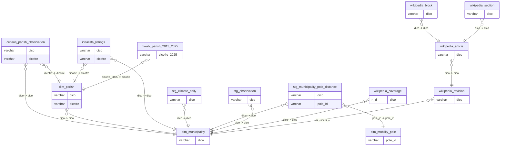

# Modelo de dados

> Arquivo gerado por `uv run --locked python -m pipelines.cli.model_docs`. Não edite à mão: o CI reprova se ele
> divergir dos `schema.yml` do dbt.

## Resumo

- Tabelas: 25 (bronze 14, silver 11)
- Relacionamentos declarados: 15
- Cobertura de descrição: tabelas 100%, colunas 95%

## Diagrama de relacionamentos

## Lacunas

### Cobertura de descrição

| Camada | Tabelas com descrição | Colunas com descrição |
| --- | --- | --- |
| bronze | 14/14 (100%) | 189/198 (95%) |
| silver | 11/11 (100%) | 158/166 (95%) |
| total | 25/25 (100%) | 347/364 (95%) |

### Sem descrição

- census_coverage.age_code
- census_coverage.coverage_status
- census_coverage.dicofre
- rpt_climate_coverage.municipalities_expected
- rpt_climate_coverage.variable
- rpt_climate_points.collected
- rpt_climate_points.dico
- rpt_mobility_coverage.expected
- rpt_mobility_coverage.mode
- rpt_mobility_coverage.pole_id
- rpt_observation_coverage.latest_period
- rpt_observation_coverage.municipalities_expected
- rpt_parish_crosswalk_coverage.attribution
- rpt_parish_crosswalk_coverage.pairs
- rpt_parish_crosswalk_coverage.relation
- wikipedia_coverage.dico
- wikipedia_coverage.status

### Chaves territoriais sem relacionamento declarado

- census_coverage.dicofre
- dim_mobility_pole.dico
- idealista_occurrences.dico
- idealista_occurrences.dicofre
- stg_caop_parishes.dico

## Dicionário de dados

### stg_caop_municipalities

- Camada: bronze | Domínio: caop | Tipo: principal
- Fontes: caop (CC-BY-4.0) — atribuição: "Fonte: Direção-Geral do Território (DGT), CAOP2025"
- Descrição: Municípios CAOP da coleta changed selecionada, com geometria de verificação.

| Coluna | Tipo | Descrição | Testes |
| --- | --- | --- | --- |
| dico | varchar | Código DICO do município na CAOP (4 dígitos: distrito/ilha + concelho); chave territorial do projeto. | not_null, unique |
| official_name | varchar | Nome oficial na CAOP. | — |
| normalized_name | varchar | Nome normalizado (minúsculas e sem acentos), para comparar e juntar nomes. | — |
| district_or_island | varchar | Distrito (continente) ou ilha (regiões autónomas) a que pertence. | — |
| autonomous_region | varchar | Nome da região autónoma (Açores ou Madeira); nulo no continente. | — |
| region | varchar | Região da coleta: `continente`, `acores` ou `madeira`. | — |
| source_crs | varchar | Sistema de coordenadas da geometria original (código EPSG). | — |
| geometry_wkb | blob | Geometria em WKB no sistema `source_crs`, mantida só para verificação. | not_null |
| area_km2 | double | Área em km², calculada sobre a geometria no sistema original. | — |
| representative_lat | double | Latitude (graus, WGS84) de um ponto interno representativo; não é o centroide. | — |
| representative_lon | double | Longitude (graus, WGS84) de um ponto interno representativo; não é o centroide. | — |
| caop_version | varchar | Edição da CAOP (ano) usada na coleta. | — |
| source_run_id | varchar | Identificador da coleta de origem (`run_id` do manifest em `manifests/<fonte>/`). | not_null |
| reference_period | varchar | Período de referência da CAOP (ano). | — |
| license_id | varchar | Licença de uso da fonte, como declarada em `config/sources.yml`. | — |
| collected_at_utc | varchar | Instante (UTC, ISO 8601) em que a fonte foi coletada, copiado do manifest. | — |
| processed_at_utc | varchar | Instante (UTC, ISO 8601) em que o build processou a linha. | — |

### stg_caop_parishes

- Camada: bronze | Domínio: caop | Tipo: principal
- Fontes: caop (CC-BY-4.0) — atribuição: "Fonte: Direção-Geral do Território (DGT), CAOP2025"
- Descrição: Freguesias CAOP da coleta changed selecionada, com geometria de verificação.

| Coluna | Tipo | Descrição | Testes |
| --- | --- | --- | --- |
| dicofre | varchar | Código DICOFRE da freguesia (6 caracteres: DICO + 2); chave territorial das freguesias. | not_null, unique |
| dico | varchar | Código DICO do município da freguesia (os 4 primeiros caracteres do DICOFRE). | not_null |
| official_name | varchar | Nome oficial da freguesia na CAOP. | — |
| normalized_name | varchar | Nome da freguesia normalizado (minúsculas e sem acentos), para comparar e juntar nomes. | — |
| district_or_island | varchar | Distrito (continente) ou ilha (regiões autónomas) a que pertence. | — |
| autonomous_region | varchar | Nome da região autónoma (Açores ou Madeira); nulo no continente. | — |
| region | varchar | Região da coleta: `continente`, `acores` ou `madeira`. | — |
| source_crs | varchar | Sistema de coordenadas da geometria original (código EPSG). | — |
| geometry_wkb | blob | Geometria em WKB no sistema `source_crs`, mantida só para verificação. | not_null |
| area_km2 | double | Área em km², calculada sobre a geometria no sistema original. | — |
| representative_lat | double | Latitude (graus, WGS84) de um ponto interno representativo; não é o centroide. | — |
| representative_lon | double | Longitude (graus, WGS84) de um ponto interno representativo; não é o centroide. | — |
| parish_type | varchar | Tipo da freguesia, quando a fonte informa; nulo na CAOP 2025 coletada. | — |
| caop_version | varchar | Edição da CAOP (ano) usada na coleta. | — |
| source_run_id | varchar | Identificador da coleta de origem (`run_id` do manifest em `manifests/<fonte>/`). | — |
| reference_period | varchar | Período de referência da CAOP (ano). | — |
| license_id | varchar | Licença de uso da fonte, como declarada em `config/sources.yml`. | — |
| collected_at_utc | varchar | Instante (UTC, ISO 8601) em que a fonte foi coletada, copiado do manifest. | — |
| processed_at_utc | varchar | Instante (UTC, ISO 8601) em que o build processou a linha. | — |

### census_age_category

- Camada: bronze | Domínio: censos | Tipo: principal
- Fontes: censos (CC-BY-4.0) — atribuição: "Fonte: INE, Recenseamento da população e habitação — Censos 2021"
- Descrição: Categorias etárias nativas do INE, específicas do indicador.

| Coluna | Tipo | Descrição | Testes |
| --- | --- | --- | --- |
| age_code | varchar | Código nativo da categoria etária no INE (`T` é o total). | not_null |
| label | varchar | Rótulo da categoria etária como publicado pelo INE (por exemplo «25 - 29 anos»). | — |
| age_min | integer | Idade mínima da faixa; nulo no total e na categoria de idade ignorada. | — |
| age_max | integer | Idade máxima da faixa; nulo no total, nas faixas abertas (85 anos ou mais) e na categoria ignorada. | — |
| is_total | boolean | Verdadeiro na categoria que soma todas as idades. | — |
| is_unknown | boolean | Verdadeiro na categoria de idade ignorada ou desconhecida. | — |
| indicator | varchar | Código do indicador do INE (`0014632` na geografia de 2025, `0011719` na de 2013). | not_null |
| geography_version | varchar | Versão da geografia de freguesias do indicador: 2013 ou 2025. | — |
| metadata_dataset_id | varchar | Identificador do dataset de metadados de onde a categoria foi lida. | — |
| raw_key | varchar | Chave, em `raw/`, do arquivo original de metadados de onde a categoria foi lida. | — |
| raw_sha256 | varchar | SHA-256 do arquivo original de metadados, para conferir a integridade. | not_null |
| license_id | varchar | Licença de uso da fonte, como declarada em `config/sources.yml`. | not_null |
| attribution | varchar | Texto de atribuição que a fonte exige ao citar o dado. | — |
| source_run_id | varchar | Identificador da coleta de origem (`run_id` do manifest da coleta dos Censos). | — |
| collected_at_utc | varchar | Instante (UTC, ISO 8601) em que a fonte foi coletada, copiado do manifest. | — |
| processed_at_utc | varchar | Instante (UTC, ISO 8601) em que o build processou a linha. | — |

### census_observation

- Camada: bronze | Domínio: censos | Tipo: principal
- Fontes: censos (CC-BY-4.0) — atribuição: "Fonte: INE, Recenseamento da população e habitação — Censos 2021"
- Descrição: Contagens censitárias nativas com originais e metadados rastreáveis.

| Coluna | Tipo | Descrição | Testes |
| --- | --- | --- | --- |
| source_dicofre | varchar | Código DICOFRE da freguesia como publicado pelo INE (na geografia `geography_version`). | not_null |
| period | varchar | Ano de referência dos Censos (2021). | — |
| age_code | varchar | Código nativo da categoria etária no INE (`T` é o total). | — |
| label | varchar | Rótulo da categoria etária como publicado pelo INE. | — |
| age_min | integer | Idade mínima da faixa; nulo no total e na categoria de idade ignorada. | — |
| age_max | integer | Idade máxima da faixa; nulo no total, nas faixas abertas (85 anos ou mais) e na categoria ignorada. | — |
| is_total | boolean | Verdadeiro na categoria que soma todas as idades. | — |
| is_unknown | boolean | Verdadeiro na categoria de idade ignorada ou desconhecida. | — |
| value | bigint | Contagem de residentes na freguesia e categoria etária; nulo quando não há valor publicado (ver `value_status`). | — |
| value_status | varchar | Estado do valor na fonte: `observed`, `suppressed`, `not_applicable` ou `not_published`. | accepted_values, not_null |
| symbol | null | Símbolo de convenção que o INE usa quando não publica o valor; nulo quando há valor. | — |
| indicator | varchar | Código do indicador do INE (`0014632` na geografia de 2025, `0011719` na de 2013). | — |
| geography_version | varchar | Versão da geografia de freguesias do indicador: 2013 ou 2025. | — |
| dataset_id | varchar | Identificador do dataset (lote de freguesias) coletado no catálogo de fontes. | — |
| raw_key | varchar | Chave, em `raw/`, do arquivo original de onde a linha veio. | — |
| raw_sha256 | varchar | SHA-256 do arquivo original em `raw/`, para conferir a integridade. | not_null |
| source_run_id | varchar | Identificador da coleta de origem (`run_id` do manifest da coleta dos Censos). | — |
| metadata_raw_key | varchar | Chave, em `raw/`, do arquivo original de metadados do indicador. | — |
| metadata_raw_sha256 | varchar | SHA-256 do arquivo original de metadados, para conferir a integridade. | not_null |
| query_signature | varchar | Assinatura da consulta ao INE (parâmetros do dataset) usada para coletar o lote. | — |
| collected_at_utc | varchar | Instante (UTC, ISO 8601) em que a fonte foi coletada, copiado do manifest. | — |
| processed_at_utc | varchar | Instante (UTC, ISO 8601) em que o build processou a linha. | — |
| license_id | varchar | Licença de uso da fonte, como declarada em `config/sources.yml`. | — |
| attribution | varchar | Texto de atribuição que a fonte exige ao citar o dado. | — |
| source_release_date | varchar | Data da última atualização do indicador, informada pelo INE (`DataUltimaAtualizacao`). | — |
| geography_evidence | varchar | Endereço dos metadados do INE que comprovam a versão da geografia. | — |
| reexpression_method | varchar | Método de reexpressão da geografia declarado pelo INE; `not_disclosed_by_publisher` se não divulgado. | — |

### rpt_climate_coverage

- Camada: bronze | Domínio: climate | Tipo: relatorio
- Fontes: não declaradas
- Descrição: Cobertura por variável, com ausentes e lacunas explícitos; missing_days_total soma lacunas dos coletados.
- Observação: as colunas listadas são só as declaradas no schema.yml; a lista pode estar incompleta.

| Coluna | Tipo | Descrição | Testes |
| --- | --- | --- | --- |
| variable | n/d | sem descrição | not_null, unique |
| municipalities_expected | n/d | sem descrição | not_null |

### rpt_climate_points

- Camada: bronze | Domínio: climate | Tipo: relatorio
- Fontes: não declaradas
- Descrição: Todos os municípios, com distância até a célula da fonte quando coletados.
- Observação: as colunas listadas são só as declaradas no schema.yml; a lista pode estar incompleta.

| Coluna | Tipo | Descrição | Testes |
| --- | --- | --- | --- |
| dico | n/d | sem descrição | not_null, unique |
| collected | n/d | sem descrição | not_null |

### stg_climate_daily

- Camada: bronze | Domínio: climate | Tipo: principal
- Fontes: open_meteo (CC-BY-4.0) — atribuição: "Dados meteorológicos: Open-Meteo.com (CC BY 4.0); reanálise ERA5, Copernicus Climate Change Service/ECMWF"
- Descrição: Clima diário municipal; valores ausentes permanecem nulos e datas são dias locais.

| Coluna | Tipo | Descrição | Testes |
| --- | --- | --- | --- |
| source_id | varchar | Fonte do clima: `open_meteo`. | not_null |
| dico | varchar | Código DICO do município cujo ponto foi coletado. | not_null, relationships |
| variable | varchar | Variável climática diária (por exemplo `temperature_2m_mean` ou `precipitation_sum`). | not_null |
| date | date | Dia local da observação. | not_null |
| value | double | Valor da variável no dia, na unidade de `unit`; nulo quando a fonte não o fornece, nunca imputado. | — |
| unit | varchar | Unidade de medida da variável (por exemplo °C, mm, km/h). | not_null |
| model | varchar | Reanálise ou modelo de origem do valor (`era5`). | not_null |
| window_start | date | Primeiro dia da janela coletada (inclusive). | — |
| window_end | date | Último dia da janela coletada (inclusive). | — |
| source_run_id | varchar | Identificador da coleta de origem (`run_id` do manifest em `manifests/<fonte>/`). | not_null |
| license_id | varchar | Licença de uso da fonte, como declarada em `config/sources.yml`. | not_null |
| attribution | varchar | Texto de atribuição que a fonte exige ao citar o dado. | — |
| usage_restriction | varchar | Restrição de uso da fonte (plano gratuito, uso não comercial; risco aceito pelo autor). | — |
| collected_at_utc | varchar | Instante (UTC, ISO 8601) em que a fonte foi coletada, copiado do manifest. | — |
| processed_at_utc | varchar | Instante (UTC, ISO 8601) em que o build processou a linha. | — |

Relacionamentos:

- `dico` -> `dim_municipality.dico`

### idealista_occurrences

- Camada: bronze | Domínio: idealista | Tipo: principal
- Fontes: idealista (not_granted_by_source) — atribuição: "Fonte: Idealista, extração manual; período informado pelo operador"; caop (CC-BY-4.0) — atribuição: "Fonte: Direção-Geral do Território (DGT), CAOP2025"
- Descrição: Todas as ocorrências do snapshot manual, com valores tipados e proveniência, sem publicação.

| Coluna | Tipo | Descrição | Testes |
| --- | --- | --- | --- |
| listing_id | varchar | Identificador do anúncio na fonte (campo `id` do arquivo importado). | not_null |
| source_id | varchar | Fonte do dado: `idealista`. | — |
| snapshot_month | varchar | Mês do snapshot manual importado (AAAA-MM). | not_null |
| dico | varchar | Código DICO do município resolvido; nulo quando o anúncio só tem região ou há conflito. | — |
| dicofre | varchar | Código DICOFRE da freguesia, quando resolvida; nulo quando só há município ou região. | — |
| locality_level | varchar | Nível da localidade resolvida: `municipio`, `freguesia`, `regiao` (sem município) ou `conflict` (ocorrências com território divergente). | — |
| locality_raw | varchar | Localidade como informada na fonte, antes da resolução territorial. | — |
| source_region | varchar | Região informada no arquivo de origem (por exemplo Norte ou Algarve). | — |
| parish_match_method | varchar | Como a freguesia foi resolvida: `arquivo`, `titulo_exato_ou_sinonimo`, `metadado_exato_ou_sinonimo`, `metadado_seed`, `nao_resolvido` ou `conflict`. | — |
| asking_rent_eur | double | Renda pedida, em euros por mês (campo `Preco`); nulo quando ausente ou inválida. | — |
| area_m2 | double | Área bruta em m² (campo `areaBrutaM2`); nulo quando ausente ou inválida. | — |
| bedrooms | bigint | Número de quartos derivado da tipologia (T2 = 2); nulo quando a tipologia é ausente ou inválida. | — |
| typology | varchar | Tipologia normalizada: `T0`, `T1`, `T2`, `T3` ou `T4+` (quatro ou mais quartos); nulo quando ausente ou inválida. | — |
| quality_flags | varchar | Alertas de qualidade separados por `&#124;` (`missing_or_invalid_price`, `missing_or_invalid_area`, `missing_or_invalid_typology`); vazio quando não há. | — |
| source_subregion | varchar | Sub-região informada no arquivo (campo `Sub-região`); nulo quando ausente. | — |
| source_municipality | varchar | Município informado no arquivo (campo `Município`); nulo quando ausente. | — |
| source_parish | varchar | Freguesia informada no arquivo (campo `Freguesia`); nulo quando ausente. | — |
| source_run_id | varchar | Identificador da importação do snapshot (`run_id` do manifest). | not_null |
| raw_key | varchar | Chave, em `raw/`, do arquivo original de onde a linha veio. | not_null |
| raw_sha256 | varchar | SHA-256 do arquivo original em `raw/`, para conferir a integridade. | not_null |
| relative_path | varchar | Caminho do arquivo dentro do snapshot importado. | — |
| source_row | bigint | Número da linha do anúncio dentro do arquivo (a partir de 1). | not_null |
| collected_at_utc | varchar | Sempre nulo: a extração manual não informa o horário de coleta de cada anúncio. | — |
| imported_at_utc | varchar | Instante (UTC, ISO 8601) em que o snapshot foi importado. | not_null |
| processed_at_utc | varchar | Instante (UTC, ISO 8601) em que o build processou a linha. | — |
| license_id | varchar | Licença da fonte: `not_granted_by_source` (não concedida; risco aceito no ADR-002 D4). | — |
| attribution | varchar | Texto de atribuição que a fonte exige ao citar o dado. | — |

### dim_mobility_pole

- Camada: bronze | Domínio: mobility | Tipo: principal
- Fontes: caop (CC-BY-4.0) — atribuição: "Fonte: Direção-Geral do Território (DGT), CAOP2025"
- Descrição: Polos vigentes de mobilidade, já resolvidos (config/poles.yml); alvo do relationships do staging.

| Coluna | Tipo | Descrição | Testes |
| --- | --- | --- | --- |
| pole_id | varchar | Identificador estável do polo (por exemplo `lisboa` ou `aeroporto_lis`). | not_null, unique |
| name | varchar | Nome do polo. | — |
| kind | varchar | Tipo do polo: `cidade`, `aeroporto`, `sede_distrito` ou `capital_regional`. | accepted_values, not_null |
| routing_group | varchar | Grupo de roteamento (`continente`, `madeira` ou `acores`); só há rota entre pontos do mesmo grupo. | — |
| scope | varchar | Municípios que medem a distância até o polo: `national` (todo o continente), `district` (mesmo distrito) ou `island` (mesma ilha). | — |
| dico | varchar | Município (DICO) do polo quando ele é um município da CAOP; nulo nos aeroportos. | — |
| latitude | double | Latitude do polo (graus, WGS84); nos polos de cidade é o ponto representativo do município na CAOP. | not_null |
| longitude | double | Longitude do polo (graus, WGS84); nos polos de cidade é o ponto representativo do município na CAOP. | not_null |
| district_or_island | varchar | Distrito ou ilha do polo, usado nos escopos `district` e `island`; pode ser nulo. | — |
| source_ref | varchar | Referência da coordenada (AIP/eAIP ou nota `APROXIMADO` a conferir); nulo nos polos de cidade. | — |

### rpt_mobility_coverage

- Camada: bronze | Domínio: mobility | Tipo: relatorio
- Fontes: não declaradas
- Descrição: Cobertura por modo e polo; ok + sem_rota + falha + pendente = expected.
- Observação: as colunas listadas são só as declaradas no schema.yml; a lista pode estar incompleta.

| Coluna | Tipo | Descrição | Testes |
| --- | --- | --- | --- |
| mode | n/d | sem descrição | not_null |
| pole_id | n/d | sem descrição | not_null |
| expected | n/d | sem descrição | not_null |

### stg_municipality_pole_distance

- Camada: bronze | Domínio: mobility | Tipo: principal
- Fontes: caop (CC-BY-4.0) — atribuição: "Fonte: Direção-Geral do Território (DGT), CAOP2025"; google_distances (not_granted_by_source) — atribuição: "Tempos de viagem: Google"
- Descrição: Distância município-polo, uma linha por par esperado e modo (linha reta, carro). `km` e `minutes` só existem em `ok`; `sem_rota`, `falha` e `pendente` ficam nulos e nunca são imputados.

| Coluna | Tipo | Descrição | Testes |
| --- | --- | --- | --- |
| source_id | varchar | Origem do cálculo: `caop` (linha reta, calculada localmente) ou `google_distances` (carro, Routes API). | accepted_values, not_null |
| dico | varchar | Código DICO do município de origem. | not_null, relationships |
| pole_id | varchar | Polo de destino (`dim_mobility_pole.pole_id`). | not_null, relationships |
| mode | varchar | Modo: `straight_line` (linha reta), `driving` (carro) ou `transit` (transporte público, fora da v1). | accepted_values, not_null |
| km | double | Distância em km; só existe quando `status` é `ok`. | — |
| minutes | double | Tempo de viagem em minutos; só existe no carro com `status` `ok` (a linha reta não tem tempo). | — |
| status | varchar | Estado do par: `ok`, `sem_rota`, `falha` ou `pendente`. | accepted_values, not_null |
| no_route_reason | varchar | Motivo quando `sem_rota` (por exemplo `ROUTE_NOT_FOUND`); nulo nos demais estados. | — |
| error | varchar | Mensagem do último erro quando `falha`; nulo nos demais estados. | — |
| method | varchar | Método de cálculo: `haversine` (linha reta), `google_routes_v2` (Routes API) ou `identity` (o município é o próprio polo, 0 km). | — |
| departure_time | varchar | Horário de partida usado no cálculo; nulo na linha reta e no carro sem horário. | — |
| stale | boolean | Verdadeiro quando o resultado guardado foi calculado com uma configuração do par que já não é a vigente. | not_null |
| calculated_at_utc | varchar | Instante (UTC, ISO 8601) em que o resultado do par foi coletado na API; nulo quando não há coleta. | — |
| source_run_id | varchar | Coleta do Google que produziu o resultado do par; nulo quando não há coleta. | — |
| caop_version | varchar | Edição da CAOP usada para as coordenadas dos municípios. | — |
| poles_catalog_version | varchar | SHA-256 do catálogo de polos resolvido usado no cálculo. | not_null |
| license_id | varchar | Licença de uso da fonte, como declarada em `config/sources.yml`. | not_null |
| attribution | varchar | Texto de atribuição que a fonte exige ao citar o dado. | — |
| usage_restriction | varchar | Restrição de uso da fonte (termos da Google Maps Platform no carro); nulo na linha reta. | — |
| reference_period | varchar | Período de referência configurado para a fonte (AAAA-MM). | not_null |
| processed_at_utc | varchar | Instante (UTC, ISO 8601) em que o build processou a linha. | — |

Relacionamentos:

- `dico` -> `dim_municipality.dico`
- `pole_id` -> `dim_mobility_pole.pole_id`

### rpt_observation_coverage

- Camada: bronze | Domínio: observations | Tipo: relatorio
- Fontes: não declaradas
- Descrição: Cobertura municipal por dataset no período mais recente; a ausência é listada, nunca imputada.
- Observação: as colunas listadas são só as declaradas no schema.yml; a lista pode estar incompleta.

| Coluna | Tipo | Descrição | Testes |
| --- | --- | --- | --- |
| dataset_id | n/d | Identificador do dataset de origem; uma linha de cobertura por dataset. | not_null, unique |
| latest_period | n/d | sem descrição | not_null |
| municipalities_expected | n/d | sem descrição | not_null |

### stg_observation

- Camada: bronze | Domínio: observations | Tipo: principal
- Fontes: pordata (not_granted_by_source) — atribuição: "Fonte: PORDATA"; ine (CC-BY-4.0) — atribuição: "Instituto Nacional de Estatística, IP – Portugal"
- Descrição: Observações municipais em formato longo (Pordata e INE), uma linha por dataset, município, período e filtros.

| Coluna | Tipo | Descrição | Testes |
| --- | --- | --- | --- |
| source_id | varchar | Fonte do dataset: `pordata` ou `ine`. | not_null |
| dataset_id | varchar | Identificador do dataset de origem dentro da fonte (`source_id`). | not_null |
| dico | varchar | Código DICO do município da observação, resolvido na normalização em Python. | not_null, relationships |
| source_name | varchar | Nome do município como veio na fonte, antes da resolução para o DICO. | — |
| period | integer | Período da observação (ano). | not_null |
| filter_1 | varchar | Rótulo do 1º filtro (dimensão) do dataset, por exemplo sexo, faixa etária ou natureza; texto vazio quando o dataset não usa o filtro. | — |
| filter_2 | varchar | Rótulo do 2º filtro (dimensão) do dataset, por exemplo sexo, faixa etária ou natureza; texto vazio quando o dataset não usa o filtro. | — |
| filter_3 | varchar | Rótulo do 3º filtro (dimensão) do dataset, por exemplo sexo, faixa etária ou natureza; texto vazio quando o dataset não usa o filtro. | — |
| value | double | Valor da observação; nulo quando a fonte não publica valor (ver `symbol`), nunca imputado. | — |
| symbol | varchar | Símbolo ou nota da fonte para a observação (por exemplo `x`, `-`, `...` ou quebra de série); nulo quando não há. | — |
| unit | varchar | Unidade de medida do valor (por exemplo pessoas, edifícios ou crimes). | not_null |
| source_run_id | varchar | Identificador da coleta de origem (`run_id` do manifest em `manifests/<fonte>/`). | not_null |
| license_id | varchar | Licença de uso da fonte, como declarada em `config/sources.yml`. | not_null |
| attribution | varchar | Texto de atribuição que a fonte exige ao citar o dado. | — |
| collected_at_utc | varchar | Instante (UTC, ISO 8601) em que a fonte foi coletada, copiado do manifest. | — |
| processed_at_utc | varchar | Instante (UTC, ISO 8601) em que o build processou a linha. | — |

Relacionamentos:

- `dico` -> `dim_municipality.dico`

### wikipedia_revision

- Camada: bronze | Domínio: wikipedia | Tipo: principal
- Fontes: wikipedia (CC-BY-SA-4.0) — atribuição: "Contribuidores da Wikipedia; texto normalizado; consultar histórico da revisão"
- Descrição: Identidades e revisões aceitas com referências aos dois originais imutáveis.

| Coluna | Tipo | Descrição | Testes |
| --- | --- | --- | --- |
| dico | varchar | Código DICO do município associado ao artigo. | not_null, relationships, unique |
| scope | varchar | Abrangência do artigo: `municipality` (só o município) ou `municipality_and_seat` (município e sede). | — |
| canonical_title | varchar | Título canônico do artigo na Wikipedia em português. | — |
| fingerprint | varchar | Impressão digital do conteúdo aceito (metadados, texto, associação e território), para detectar mudança. | — |
| association_hash | varchar | Hash da associação curada entre o município e o artigo. | — |
| territory_hash | varchar | SHA-256 da dimensão territorial (`dim_municipality`) congelada usada na coleta. | — |
| source_run_id | varchar | Coleta em que a revisão foi verificada pela última vez. | — |
| checked_at_utc | varchar | Instante (UTC, ISO 8601) da última verificação do artigo. | — |
| revision_at_utc | varchar | Instante (UTC, ISO 8601) da revisão aceita, conforme a Wikipedia. | — |
| permanent_url | varchar | Endereço permanente da revisão aceita. | — |
| metadata_raw_key | varchar | Chave, em `raw/`, do arquivo original de metadados da página. | — |
| metadata_raw_sha256 | varchar | SHA-256 do arquivo original de metadados, para conferir a integridade. | not_null |
| content_raw_key | varchar | Chave, em `raw/`, do arquivo original com o conteúdo da página. | — |
| content_raw_sha256 | varchar | SHA-256 do arquivo original de conteúdo, para conferir a integridade. | not_null |
| metadata_raw_collected_at_utc | varchar | Instante (UTC) em que o arquivo de metadados foi coletado. | — |
| content_raw_collected_at_utc | varchar | Instante (UTC) em que o arquivo de conteúdo foi coletado. | — |
| manifest_key | varchar | Chave do manifest da Wikipedia que registra esta revisão. | — |
| processing_signature | varchar | Assinatura do processamento (entradas do manifest, território e código), para saber se a saída está atual. | — |
| page_id | bigint | Identificador numérico da página na Wikipedia. | — |
| revision_id | bigint | Identificador numérico da revisão aceita na Wikipedia. | not_null |

Relacionamentos:

- `dico` -> `dim_municipality.dico`

### dim_municipality

- Camada: silver | Domínio: caop | Tipo: principal
- Fontes: caop (CC-BY-4.0) — atribuição: "Fonte: Direção-Geral do Território (DGT), CAOP2025"
- Descrição: Uma linha por município vigente da CAOP.

| Coluna | Tipo | Descrição | Testes |
| --- | --- | --- | --- |
| dico | varchar | Código DICO do município na CAOP (4 dígitos: distrito/ilha + concelho); chave territorial do projeto. | not_null, unique |
| official_name | varchar | Nome oficial na CAOP. | not_null |
| normalized_name | varchar | Nome normalizado (minúsculas e sem acentos), para comparar e juntar nomes. | not_null |
| district_or_island | varchar | Distrito (continente) ou ilha (regiões autónomas) a que pertence. | — |
| autonomous_region | varchar | Nome da região autónoma (Açores ou Madeira); nulo no continente. | — |
| area_km2 | double | Área em km², calculada sobre a geometria no sistema original. | not_null |
| representative_lat | double | Latitude (graus, WGS84) de um ponto interno representativo; não é o centroide. | not_null |
| representative_lon | double | Longitude (graus, WGS84) de um ponto interno representativo; não é o centroide. | not_null |
| caop_version | varchar | Edição da CAOP (ano) usada na coleta. | — |
| source_run_id | varchar | Identificador da coleta de origem (`run_id` do manifest em `manifests/<fonte>/`). | not_null |
| reference_period | varchar | Período de referência da CAOP (ano). | — |
| license_id | varchar | Licença de uso da fonte, como declarada em `config/sources.yml`. | — |
| collected_at_utc | varchar | Instante (UTC, ISO 8601) em que a fonte foi coletada, copiado do manifest. | — |
| processed_at_utc | varchar | Instante (UTC, ISO 8601) em que o build processou a linha. | — |

### dim_parish

- Camada: silver | Domínio: caop | Tipo: principal
- Fontes: caop (CC-BY-4.0) — atribuição: "Fonte: Direção-Geral do Território (DGT), CAOP2025"
- Descrição: Uma linha por código oficial de freguesia vigente da CAOP.

| Coluna | Tipo | Descrição | Testes |
| --- | --- | --- | --- |
| dicofre | varchar | Código DICOFRE da freguesia (6 caracteres: DICO + 2); chave territorial das freguesias. | not_null, unique |
| dico | varchar | Código DICO do município da freguesia (os 4 primeiros caracteres do DICOFRE). | not_null, relationships |
| official_name | varchar | Nome oficial da freguesia na CAOP. | not_null |
| normalized_name | varchar | Nome da freguesia normalizado (minúsculas e sem acentos), para comparar e juntar nomes. | not_null |
| district_or_island | varchar | Distrito (continente) ou ilha (regiões autónomas) a que pertence. | — |
| autonomous_region | varchar | Nome da região autónoma (Açores ou Madeira); nulo no continente. | — |
| parish_type | varchar | Tipo da freguesia, quando a fonte informa; nulo na CAOP 2025 coletada. | — |
| area_km2 | double | Área em km², calculada sobre a geometria no sistema original. | not_null |
| representative_lat | double | Latitude (graus, WGS84) de um ponto interno representativo; não é o centroide. | not_null |
| representative_lon | double | Longitude (graus, WGS84) de um ponto interno representativo; não é o centroide. | not_null |
| caop_version | varchar | Edição da CAOP (ano) usada na coleta. | — |
| source_run_id | varchar | Identificador da coleta de origem (`run_id` do manifest em `manifests/<fonte>/`). | not_null |
| reference_period | varchar | Período de referência da CAOP (ano). | — |
| license_id | varchar | Licença de uso da fonte, como declarada em `config/sources.yml`. | — |
| collected_at_utc | varchar | Instante (UTC, ISO 8601) em que a fonte foi coletada, copiado do manifest. | — |
| processed_at_utc | varchar | Instante (UTC, ISO 8601) em que o build processou a linha. | — |

Relacionamentos:

- `dico` -> `dim_municipality.dico`

### census_coverage

- Camada: silver | Domínio: censos | Tipo: relatorio
- Fontes: não declaradas
- Descrição: Cobertura por freguesia e categoria, preservando as ausências motivadas.
- Observação: as colunas listadas são só as declaradas no schema.yml; a lista pode estar incompleta.

| Coluna | Tipo | Descrição | Testes |
| --- | --- | --- | --- |
| dicofre | n/d | sem descrição | not_null |
| age_code | n/d | sem descrição | not_null |
| coverage_status | n/d | sem descrição | not_null |

### census_parish_observation

- Camada: silver | Domínio: censos | Tipo: principal
- Fontes: censos (CC-BY-4.0) — atribuição: "Fonte: INE, Recenseamento da população e habitação — Censos 2021"; caop (CC-BY-4.0) — atribuição: "Fonte: Direção-Geral do Território (DGT), CAOP2025"; ine_parish_crosswalk (CC-BY-4.0) — atribuição: "Instituto Nacional de Estatística, IP – Portugal"
- Descrição: Uma observação por freguesia vigente/categoria, com cobertura e proveniência por observação.

| Coluna | Tipo | Descrição | Testes |
| --- | --- | --- | --- |
| age_code | varchar | Código canônico da faixa etária (`T` total, `unknown`, `<mín>_<máx>` ou `<mín>_plus`), harmonizado entre as geografias. | not_null |
| age_min | integer | Idade mínima da faixa; nulo no total e na categoria de idade ignorada. | — |
| age_max | integer | Idade máxima da faixa; nulo no total, nas faixas abertas (85 anos ou mais) e na categoria ignorada. | — |
| is_total | boolean | Verdadeiro na categoria que soma todas as idades. | — |
| is_unknown | boolean | Verdadeiro na categoria de idade ignorada ou desconhecida. | — |
| source_dicofre | varchar | Código DICOFRE da freguesia na geografia de origem do valor (2013 ou 2025); nulo quando falta o registro de origem. | — |
| period | varchar | Ano de referência dos Censos (2021). | — |
| label | varchar | Rótulo da categoria etária como publicado pelo INE. | — |
| value | bigint | Contagem de residentes na freguesia e categoria etária; nulo quando não há valor publicado (ver `value_status`). | — |
| value_status | varchar | Estado do valor na fonte: `observed`, `suppressed`, `not_applicable` ou `not_published`. | — |
| symbol | null | Símbolo de convenção que o INE usa quando não publica o valor; nulo quando há valor. | — |
| indicator | varchar | Código do indicador do INE (`0014632` na geografia de 2025, `0011719` na de 2013). | — |
| geography_version | varchar | Versão da geografia de freguesias do indicador: 2013 ou 2025. | — |
| dataset_id | varchar | Identificador do dataset de origem; lista JSON quando a faixa de 85 anos ou mais resulta da união de duas categorias da geografia de 2013. | — |
| raw_key | varchar | Chave, em `raw/`, do arquivo original com a contagem; lista JSON quando a faixa de 85 anos ou mais resulta da união de duas categorias da geografia de 2013. | — |
| raw_sha256 | varchar | SHA-256 do arquivo original; lista JSON quando a faixa de 85 anos ou mais resulta da união de duas categorias da geografia de 2013. | — |
| source_run_id | varchar | Identificador da coleta de origem; lista JSON quando a faixa de 85 anos ou mais resulta da união de duas categorias da geografia de 2013. | — |
| metadata_raw_key | varchar | Chave, em `raw/`, do arquivo original de metadados do indicador. | — |
| metadata_raw_sha256 | varchar | SHA-256 do arquivo original de metadados, para conferir a integridade. | — |
| query_signature | varchar | Assinatura da consulta ao INE (parâmetros do dataset) usada para coletar o lote. | — |
| collected_at_utc | varchar | Instante (UTC, ISO 8601) da coleta de origem; lista JSON quando a faixa de 85 anos ou mais resulta da união de duas categorias da geografia de 2013. | — |
| processed_at_utc | varchar | Instante (UTC, ISO 8601) em que o build processou a linha. | — |
| license_id | varchar | Licença de uso da fonte, como declarada em `config/sources.yml`. | — |
| attribution | varchar | Texto de atribuição que a fonte exige ao citar o dado. | — |
| source_release_date | varchar | Data da última atualização do indicador, informada pelo INE (`DataUltimaAtualizacao`). | — |
| geography_evidence | varchar | Endereço dos metadados do INE que comprovam a versão da geografia. | — |
| reexpression_method | varchar | Método de reexpressão da geografia declarado pelo INE; `not_disclosed_by_publisher` se não divulgado. | — |
| source_age_codes | varchar | Códigos nativos do INE que originaram a faixa, em lista JSON (a faixa 85+ junta duas). | — |
| dicofre | varchar | Código DICOFRE da freguesia vigente (CAOP 2025) a que a observação se refere. | not_null, relationships |
| dico | varchar | Código DICO do município da freguesia. | not_null, relationships |
| caop_version | varchar | Edição da CAOP do território de destino (2025). | — |
| autonomous_region | varchar | Região de referência: `continente` ou o nome da região autónoma. | — |
| coverage_status | varchar | `own` (valor próprio da freguesia), `inherited` (herdado de freguesia de 2013 dividida) ou `missing` (sem valor; ver `reason`). | accepted_values, not_null |
| reason | null | Motivo da ausência quando `missing` (`territorial_ambiguity`, `official_suppression`, `official_not_applicable`, `official_not_published` ou `missing_source`); nulo quando há valor. | — |
| relation | varchar | Relação com a freguesia de origem: `direct` ou a natureza da correspondência 2013 → 2025 (`one_to_one`, `one_to_many`, `many_to_one`, `many_to_many`). | — |
| partial_origin | boolean | Verdadeiro quando a origem de 2013 é parcial (ambiguidade territorial). | — |
| dim_parish_sha256 | varchar | SHA-256 do parquet de `dim_parish` usado no cálculo (dependência). | — |
| dim_municipality_sha256 | varchar | SHA-256 do parquet de `dim_municipality` usado no cálculo (dependência). | — |
| xwalk_parish_2013_2025_sha256 | varchar | SHA-256 do parquet de `xwalk_parish_2013_2025` usado no cálculo (dependência). | — |

Relacionamentos:

- `dico` -> `dim_municipality.dico`
- `dicofre` -> `dim_parish.dicofre`

### idealista_listings

- Camada: silver | Domínio: idealista | Tipo: principal
- Fontes: idealista (not_granted_by_source) — atribuição: "Fonte: Idealista, extração manual; período informado pelo operador"; caop (CC-BY-4.0) — atribuição: "Fonte: Direção-Geral do Território (DGT), CAOP2025"
- Descrição: Um anúncio por ID no snapshot escolhido; duplicatas e conflitos explícitos. Não é um agregado publicável.

| Coluna | Tipo | Descrição | Testes |
| --- | --- | --- | --- |
| listing_id | varchar | Identificador do anúncio na fonte (campo `id` do arquivo importado). | not_null, unique |
| source_id | varchar | Fonte do dado: `idealista`. | accepted_values |
| snapshot_month | varchar | Mês do snapshot manual importado (AAAA-MM). | not_null |
| dico | varchar | Código DICO do município resolvido; nulo quando o anúncio só tem região ou há conflito. | relationships |
| dicofre | varchar | Código DICOFRE da freguesia, quando resolvida; nulo quando só há município ou região. | relationships |
| locality_level | varchar | Nível da localidade resolvida: `municipio`, `freguesia`, `regiao` (sem município) ou `conflict` (ocorrências com território divergente). | accepted_values, not_null |
| locality_raw | varchar | Localidade como informada na fonte, antes da resolução territorial. | — |
| source_region | varchar | Região informada no arquivo de origem (por exemplo Norte ou Algarve). | — |
| parish_match_method | varchar | Como a freguesia foi resolvida: `arquivo`, `titulo_exato_ou_sinonimo`, `metadado_exato_ou_sinonimo`, `metadado_seed`, `nao_resolvido` ou `conflict`. | — |
| asking_rent_eur | double | Renda pedida, em euros por mês (campo `Preco`); nulo quando ausente ou inválida. | — |
| area_m2 | double | Área bruta em m² (campo `areaBrutaM2`); nulo quando ausente ou inválida. | — |
| bedrooms | bigint | Número de quartos derivado da tipologia (T2 = 2); nulo quando a tipologia é ausente ou inválida. | — |
| typology | varchar | Tipologia normalizada: `T0`, `T1`, `T2`, `T3` ou `T4+` (quatro ou mais quartos); nulo quando ausente ou inválida. | accepted_values |
| quality_flags | varchar | Alertas de qualidade separados por `&#124;` (`missing_or_invalid_price`, `missing_or_invalid_area`, `missing_or_invalid_typology`); vazio quando não há. | — |
| source_subregion | varchar | Sub-região informada no arquivo (campo `Sub-região`); nulo quando ausente. | — |
| source_municipality | varchar | Município informado no arquivo (campo `Município`); nulo quando ausente. | — |
| source_parish | varchar | Freguesia informada no arquivo (campo `Freguesia`); nulo quando ausente. | — |
| source_run_id | varchar | Identificador da importação do snapshot (`run_id` do manifest). | — |
| raw_key | varchar | Chave, em `raw/`, do arquivo original de onde a linha veio. | — |
| raw_sha256 | varchar | SHA-256 do arquivo original em `raw/`, para conferir a integridade. | — |
| relative_path | varchar | Caminho do arquivo dentro do snapshot importado. | — |
| source_row | bigint | Número da linha do anúncio dentro do arquivo (a partir de 1). | — |
| collected_at_utc | varchar | Sempre nulo: a extração manual não informa o horário de coleta de cada anúncio. | — |
| imported_at_utc | varchar | Instante (UTC, ISO 8601) em que o snapshot foi importado. | — |
| processed_at_utc | varchar | Instante (UTC, ISO 8601) em que o build processou a linha. | — |
| license_id | varchar | Licença da fonte: `not_granted_by_source` (não concedida; risco aceito no ADR-002 D4). | not_null |
| attribution | varchar | Texto de atribuição que a fonte exige ao citar o dado. | not_null |
| occurrence_count | bigint | Quantas ocorrências do mesmo `listing_id` existem no snapshot. | — |
| duplicate_count | bigint | Quantas ocorrências além da escolhida (`occurrence_count` menos 1). | not_null |
| has_conflict | boolean | Verdadeiro quando as ocorrências do anúncio divergem em algum dos campos de `conflict_fields`. | not_null |
| conflict_fields | varchar | Campos que divergem entre as ocorrências, separados por `&#124;` (entre `asking_rent_eur`, `area_m2`, `bedrooms`, `dico` e `dicofre`); vazio sem conflito. | — |

Relacionamentos:

- `dico` -> `dim_municipality.dico`
- `dicofre` -> `dim_parish.dicofre`

### rpt_parish_crosswalk_coverage

- Camada: silver | Domínio: parish_crosswalk | Tipo: relatorio
- Fontes: não declaradas
- Descrição: Cobertura da correspondência: uma linha por natureza da relação e uma linha `all` com os totais, a cobertura da dim_parish e as estatísticas das tabelas de origem. A ausência é listada, nunca imputada.
- Observação: as colunas listadas são só as declaradas no schema.yml; a lista pode estar incompleta.

| Coluna | Tipo | Descrição | Testes |
| --- | --- | --- | --- |
| relation | n/d | sem descrição | not_null, unique |
| pairs | n/d | sem descrição | not_null |
| attribution | n/d | sem descrição | not_null |

### xwalk_parish_2013_2025

- Camada: silver | Domínio: parish_crosswalk | Tipo: principal
- Fontes: ine_parish_crosswalk (CC-BY-4.0) — atribuição: "Instituto Nacional de Estatística, IP – Portugal"
- Descrição: Correspondência de freguesias entre a divisão de 2013 e a CAOP 2025, uma linha por par. A relação e os sinais (herdado, origem parcial, nome e município alterados) orientam quem consome; nenhum valor é repartido.

| Coluna | Tipo | Descrição | Testes |
| --- | --- | --- | --- |
| dicofre_2013 | varchar | Código DICOFRE da freguesia na divisão de 2013. | not_null |
| name_2013 | varchar | Nome da freguesia na divisão de 2013. | — |
| dicofre_2025 | varchar | Código DICOFRE da freguesia na CAOP 2025. | not_null, relationships |
| name_2025 | varchar | Nome da freguesia na CAOP 2025. | — |
| relation | varchar | Natureza da relação do par: `one_to_one`, `one_to_many` (a de 2013 se divide), `many_to_one` (várias se juntam) ou `many_to_many`. | accepted_values, not_null |
| inherited | boolean | Verdadeiro quando a freguesia de 2013 tem mais de um destino em 2025; é só um sinal, nenhum valor é repartido. | not_null |
| partial_origin | boolean | Verdadeiro quando alguma das origens pré-2013 do par contribui só em parte (marcada como parcial na planilha A do INE). | not_null |
| name_changed | boolean | Verdadeiro quando o nome mudou entre 2013 e 2025 (comparação normalizada). | not_null |
| municipality_changed | boolean | Verdadeiro quando o município (os 4 primeiros dígitos do DICOFRE) mudou entre 2013 e 2025. | not_null |
| pre2013_codes | varchar[] | Códigos das freguesias anteriores a 2013 que deram origem ao par. | not_null |
| source_run_id_2013 | varchar | Coleta da planilha A do INE (freguesias pré-2013 → 2013). | not_null |
| source_run_id_2025 | varchar | Coleta da planilha B do INE (freguesias pré-2013 repostas → 2025). | not_null |
| sha256_2013 | varchar | SHA-256 do arquivo original da planilha A. | not_null |
| sha256_2025 | varchar | SHA-256 do arquivo original da planilha B. | not_null |
| license_id | varchar | Licença de uso da fonte, como declarada em `config/sources.yml`. | not_null |
| attribution | varchar | Texto de atribuição que a fonte exige ao citar o dado. | — |
| collected_at_utc | varchar | Instante (UTC, ISO 8601) em que a fonte foi coletada, copiado do manifest. | — |
| processed_at_utc | varchar | Instante (UTC, ISO 8601) em que o build processou a linha. | — |

Relacionamentos:

- `dicofre_2025` -> `dim_parish.dicofre`

### wikipedia_article

- Camada: silver | Domínio: wikipedia | Tipo: principal
- Fontes: wikipedia (CC-BY-SA-4.0) — atribuição: "Contribuidores da Wikipedia; texto normalizado; consultar histórico da revisão"
- Descrição: Texto editorial português; narrativa não equivale a indicador estatístico.

| Coluna | Tipo | Descrição | Testes |
| --- | --- | --- | --- |
| dico | varchar | Código DICO do município associado ao artigo. | not_null, relationships, unique |
| scope | varchar | Abrangência do artigo: `municipality` (só o município) ou `municipality_and_seat` (município e sede). | — |
| canonical_title | varchar | Título canônico do artigo na Wikipedia em português. | — |
| introduction | varchar | Texto da introdução (seção inicial), em texto simples. | — |
| full_text | varchar | Texto completo do artigo em texto simples, com as seções separadas por linha em branco. | not_null |
| wikidata_id | varchar | Identificador do item na Wikidata (QID); nulo quando a página não tem. | — |
| english_url | varchar | Endereço do artigo em inglês (link interlíngua); nulo quando não existe. | — |
| permanent_url | varchar | Endereço permanente da revisão aceita. | not_null |
| history_url | varchar | Endereço do histórico de edições do artigo. | — |
| revision_at_utc | varchar | Instante (UTC, ISO 8601) da revisão aceita, conforme a Wikipedia. | — |
| metadata_observed_at_utc | varchar | Instante (UTC, ISO 8601) em que os metadados da página foram observados. | — |
| license_id | varchar | Licença do texto (`CC-BY-SA-4.0`). | accepted_values, not_null |
| license_url | varchar | Endereço da licença do texto. | — |
| attribution | varchar | Texto de atribuição exigido pela licença (contribuidores da Wikipedia). | — |
| normalization | varchar | Versão do extrator que normalizou o texto (por exemplo `wikipedia-dom-1`). | — |
| processing_signature | varchar | Assinatura do processamento (entradas do manifest, território e código), para saber se a saída está atual. | not_null |
| audit_json | varchar | Auditoria da extração em JSON (nós de texto do HTML e quantos foram cobertos pelos blocos). | — |
| processed_at_utc | varchar | Instante (UTC, ISO 8601) em que o build processou a linha. | — |
| page_id | bigint | Identificador numérico da página na Wikipedia. | — |
| revision_id | bigint | Identificador numérico da revisão aceita na Wikipedia. | — |

Relacionamentos:

- `dico` -> `wikipedia_revision.dico`

### wikipedia_block

- Camada: silver | Domínio: wikipedia | Tipo: principal
- Fontes: wikipedia (CC-BY-SA-4.0) — atribuição: "Contribuidores da Wikipedia; texto normalizado; consultar histórico da revisão"
- Descrição: Blocos de texto de cada artigo (parágrafos, listas, tabelas e seus elementos), com links e contexto HTML.

| Coluna | Tipo | Descrição | Testes |
| --- | --- | --- | --- |
| dico | varchar | Código DICO do município do artigo. | not_null, relationships |
| block_id | varchar | Identificador do bloco dentro do artigo (`b000001`, `b000002`...). | not_null |
| section_id | varchar | Seção do artigo a que o bloco pertence. | not_null |
| parent_block_id | varchar | Bloco que contém este (lista, tabela, linha); nulo nos blocos de topo. | — |
| kind | varchar | Tipo do elemento: `p`, `li`, `ul`, `ol`, `table`, `tr`, `td`, `th`, `caption`, `figure`, `figcaption` ou `text`. | not_null |
| text | varchar | Texto do bloco; pode ser nulo em blocos que só agrupam outros. | — |
| links_json | varchar | Links do bloco em JSON (destino, texto e tipo: `link`, `reference` ou `unsafe`). | — |
| context_json | varchar | Atributos HTML do bloco em JSON (`id`, `class`, `colspan`, `rowspan`, `scope`). | — |
| processing_signature | varchar | Assinatura do processamento (entradas do manifest, território e código), para saber se a saída está atual. | — |
| block_order | bigint | Posição do bloco na ordem do artigo (a partir de 0). | — |

Relacionamentos:

- `dico` -> `wikipedia_article.dico`

### wikipedia_coverage

- Camada: silver | Domínio: wikipedia | Tipo: relatorio
- Fontes: não declaradas
- Descrição: Cobertura por município: estado da associação com o artigo, se a identidade foi validada, se a extração ficou completa e as contagens de seções, blocos e caracteres; a ausência é listada, nunca imputada.
- Observação: as colunas listadas são só as declaradas no schema.yml; a lista pode estar incompleta.

| Coluna | Tipo | Descrição | Testes |
| --- | --- | --- | --- |
| official_name | n/d | Nome oficial municipal da dimensão CAOP congelada, independente do título do artigo. | not_null |
| dico | n/d | sem descrição | not_null, relationships, unique |
| status | n/d | sem descrição | accepted_values, not_null |

Relacionamentos:

- `dico` -> `dim_municipality.dico`

### wikipedia_section

- Camada: silver | Domínio: wikipedia | Tipo: principal
- Fontes: wikipedia (CC-BY-SA-4.0) — atribuição: "Contribuidores da Wikipedia; texto normalizado; consultar histórico da revisão"
- Descrição: Seções de cada artigo (a introdução é a seção `lead`), na ordem em que aparecem.

| Coluna | Tipo | Descrição | Testes |
| --- | --- | --- | --- |
| dico | varchar | Código DICO do município do artigo. | not_null, relationships |
| section_id | varchar | Identificador da seção dentro do artigo; `lead` é a introdução. | not_null |
| parent_section_id | varchar | Seção que contém esta, quando é uma subseção; nulo nas seções de topo. | — |
| title | varchar | Título da seção; vazio na introdução. | — |
| anchor | varchar | Âncora HTML da seção; nulo na introdução. | — |
| processing_signature | varchar | Assinatura do processamento (entradas do manifest, território e código), para saber se a saída está atual. | — |
| section_order | bigint | Posição da seção na ordem do artigo (0 é a introdução). | — |
| level | bigint | Nível do título (0 na introdução; 2 a 6 conforme o nível do cabeçalho). | not_null |
| empty | boolean | Verdadeiro quando a seção não tem blocos de texto próprios. | — |

Relacionamentos:

- `dico` -> `wikipedia_article.dico`
