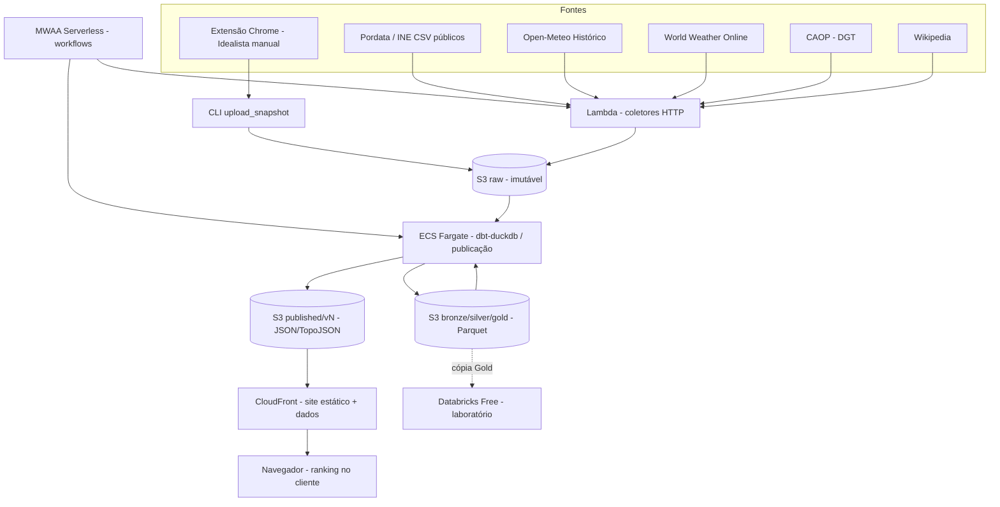

# Plano de arquitetura e implementação — Plataforma de recomendação de localidades para viver em Portugal

**Versão:** 2.2 (v2.1 + jornada do usuário, catálogo de critérios e saída infográfica)  
**Data de referência:** 03/11/2026  
**Versão anterior:** 1.0 (03/11/2026), arquitetura de referência sem auditoria do legado  
**Estado:** decisões de produto fechadas; custos e MWAA Serverless ainda a homologar em PoC  
**Escopo territorial:** Portugal inteiro (continente, Açores e Madeira), em dois níveis: **município** (ranking principal) → **freguesia** (drill-down)

> **Decisão executiva (revisada):** construir em duas fases um produto público, anônimo e bilíngue (PT-BR + EN) que recomenda municípios portugueses com pesos configuráveis e, dentro de cada município, ordena as **freguesias** com os dados disponíveis nesse nível. A **Fase A (MVP de portfólio)** é um site estático com dados versionados e ranking calculado no navegador. O pipeline mensal roda em **AWS**: **MWAA Serverless** orquestra, **dbt Core + DuckDB** transforma e o **S3** guarda os dados. O **Databricks Free Edition** é só laboratório. A **Fase B (produto)** acrescenta a API oficial do Idealista, ML nacional de aluguel e uma API dinâmica, se houver tração. A auditoria mostrou que o volume real é cerca de **100× menor** que o estimado na v1.0, o que torna a meta de **< US$ 10/mês** plausível. Ela ainda precisa ser medida na PoC.

---

## 0. O que mudou da v1.0 para a v2.0

| Tema | v1.0 supunha | Auditoria / entrevista mostrou | Impacto no plano |
|---|---|---|---|
| Volume Idealista | 1–10 GB brutos | **1 snapshot (2025-08), cerca de 30 MB de JSON, 17.472 linhas, 16.117 anúncios únicos** | Infra muito menor; DuckDB sobra; custo de S3 desprezível |
| Coletor | Scraper com navegador containerizável | **Extensão Chrome MV3 operada manualmente**, com proxy e captcha; Selenium legado abandonado | Coleta **manual + upload**; não vai para Fargate |
| Política de coleta | Indefinida | Manter Idealista "sem ofender as regras do site", de forma sustentável, até sair a **API oficial (já solicitada)** | Novo código de conduta de coleta (§3.4) |
| Segredos | "Fora do Git" como princípio | **Credenciais reais no histórico Git** (repositórios privados) | Fase 0 bloqueante: rotacionar e limpar o histórico |
| Código legado | "A auditar" | `idealistaProcessData.py` **não compila**; caminhos Windows relativos; junção por nome | Reescrever como pacote, reaproveitando a lógica |
| Clima | WWO | WWO cobre **1 ano** (07/2024–06/2025) com 5 chaves em rodízio | **WWO (1 chave) + Open-Meteo Histórico** para médias climáticas |
| Modelo de aluguel | "Auditar e reaproveitar" | TCC 2023, **só Lisboa**, divisão aleatória, R² ≈ 0,78, MAE ≈ €131 | **Não reaproveitar no MVP**; usar estatística descritiva |
| Territórios | Código oficial "a adotar" | Idealista mistura município, **freguesias de Lisboa** e **região única nas ilhas**; o último trecho do título do anúncio traz a freguesia (455 localidades, **195 com n ≥ 10**) | Dois níveis: município (DICO) → freguesia (DICOFRE); bandeira de cobertura e herança de valores |
| Limites geográficos | Não citado | GADM (licença restringe redistribuição e uso comercial) | Trocar por **CAOP (DGT)** |
| API | Lambda + API Gateway com `POST /recommendations` | Cerca de 308 municípios × dezenas de indicadores cabem em < 1 MB | Fase A: **JSON estático versionado + ranking no navegador** |
| Público | Indefinido | Imigrantes lusófonos e internacionais | Interface **PT-BR + EN** |
| Capacidade | Indefinida | **5–10 h/semana** | Roteiro com cerca de 22–26 semanas até o MVP (§15) |

---

## 1. Objetivos e critérios de sucesso

### 1.1 Produto

Transformar os projetos [MPAlugueisLisboa](C:\Users\johns\Documents\Projetos\MPAlugueisLisboa) (notebooks e relatórios manuais, TCC de 2023) e [IdealistaScraper](C:\Users\johns\Documents\Projetos\IdealistaScraper) (extensão de coleta) numa **plataforma web pública, interativa e nacional** de recomendação de municípios.

**Público-alvo:** pessoas que planejam morar em Portugal, com foco em imigrantes lusófonos (Brasil) e internacionais. A interface é **PT-BR e EN**.

**Fases do produto:**

| Fase | Objetivo | Critério para avançar |
|---|---|---|
| **A — MVP de portfólio** | Site público funcional, pipeline automatizado, stack demonstrável (AWS, MWAA, dbt, Terraform, CI/CD) | MVP no ar, custo medido, dados com proveniência |
| **B — Produto** | Qualidade de dados e funcionalidades para uso real | API oficial do Idealista disponível, ≥ 3 snapshots mensais, sinais de uso |

**Jornada de referência (definida pelo responsável):**

> O usuário entra e informa o **aluguel que pode pagar**. Depois indica **preferência de clima** e de variáveis como **cultura, economia, educação, emprego, população, saúde, segurança, distância entre capitais** e outros aspectos disponíveis. Para cada uma ele pode **selecionar valores** (ex.: faixa aceitável) ou **atribuir pesos** ao que considera mais importante. Por trás, o sistema já tem uma **base vigente processada**: só aplica as preferências e **renderiza as recomendações em estilo infográfico**.

Consequências de arquitetura: nenhum processamento pesado por requisição. A base vigente é o `published/current` (§4.1), e o cálculo é o `ranker` no navegador (§8). A saída é um painel infográfico (§9.2), não uma tabela.

**Funcionalidades do MVP (Fase A):**

1. Explorar municípios em mapa coroplético, lista e fichas de indicadores.
2. Informar orçamento mensal de aluguel e tipologia (T0–T4+) como **restrição principal**.
3. Para cada critério do catálogo (§8.1), escolher um modo: **não importa**, **peso** (0–5) ou **faixa de valores** (filtro eliminatório). Para os critérios categóricos (clima, porte populacional), escolher uma opção.
4. Receber o ranking personalizado como **infográfico**: contribuição de cada categoria, comparação com a média nacional, cobertura e data dos dados.
5. Ver **aluguel descritivo**: mediana e P25–P75 por município e tipologia, com tamanho de amostra. Aparece ao lado da mediana oficial do INE.
5a. **Drill-down por freguesia:** ao abrir um município, ver as freguesias no mapa e numa lista ordenada pelos mesmos pesos. Cada indicador mostra a origem: **próprio da freguesia** ou **herdado do município** (§8.3).
6. Sinalizar dados ausentes ou de baixa amostra sem preencher com valor fictício.
7. Uso anônimo; as preferências ficam apenas no navegador (URL compartilhável e `localStorage`).
8. Páginas de metodologia, fontes/atribuições e privacidade, em PT-BR e EN.

**Fora do MVP (Fase B ou mais tarde):** ML de aluguel nacional, `POST /recommendations` server-side, preferências persistidas no servidor, ranking nacional direto de freguesias (sem passar pelo município), bairros/lugares abaixo da freguesia, destino livre de mobilidade (API de rotas), chatbot/LLM, dados em tempo real, monetização.

### 1.2 Objetivos não funcionais

- Site 24/7 sem alta disponibilidade estrita (hosting estático em CDN).
- Até cerca de 100 acessos/dia inicialmente (estimativa).
- Atualização imobiliária **mensal**, com coleta manual e o resto automático. Demais fontes conforme a publicação.
- Histórico bruto completo e imutável; reconstrução de qualquer versão publicada.
- Deploy automatizado após aprovação, com testes e rollback.
- Orçamento: **US$ 100 em créditos AWS** por até 6 meses; meta posterior **< US$ 10/mês**, a medir.
- Terraform + GitHub; **nenhum segredo no Git**.

### 1.3 Indicadores de aceitação

| Domínio | Critério | Evidência |
|---|---|---|
| Segredos | Zero credenciais no histórico do monorepo; credenciais antigas revogadas | `gitleaks` no CI; registro de rotação |
| Ingestão | Snapshot com manifest (§5.2); reexecução não duplica | Testes de idempotência |
| Território | 308 municípios com código DICO; 100% das fontes ligadas por código, não por nome | Teste dbt `relationships` |
| Cobertura | Cobertura por fonte e município visível no site | Mart de qualidade |
| Recomendação | Restrições respeitadas; pesos 0 excluem o critério; determinístico | Testes "golden" no CI |
| Transparência | Cada indicador com fonte, período de referência e licença | Ficha do município |
| Aluguel | Mediana só com n ≥ limiar (proposta: 10); senão, "amostra insuficiente" | Teste dbt + UI |
| Deploy | PR → checks → aprovação → apply → smoke test | GitHub Actions |
| Custo | Gasto observado ≤ US$ 16,67/mês nos créditos; projeção < US$ 10 depois | Budgets e Cost Explorer |

---

## 2. Registro consolidado de decisões

| Tema | Decisão | Origem | Estado |
|---|---|---|---|
| Objetivo | Portfólio primeiro, produto depois (fases A/B) | Entrevista v2 | Confirmado |
| Cobertura | Portugal inteiro, por município | v1 | Confirmado |
| Público e idioma | Imigrantes lusófonos e internacionais; PT-BR + EN | Entrevista v2 | Confirmado |
| Idealista no produto | Manter, com coleta sustentável (§3.4), até a API oficial (já solicitada) | Entrevista v2 | Confirmado; risco aceito (§14) |
| Coleta Idealista | Manual via extensão, mensal; upload ao S3 por CLI; pipeline automático depois | Entrevista v2 | Confirmado |
| Orquestração | **MWAA Serverless** | Entrevista v2 | Confirmado; PoC de elegibilidade e custo |
| Transformação | dbt Core + DuckDB | v1 | Confirmado |
| Clima | WWO (1 chave, em segredo) + Open-Meteo Histórico (médias de 10–30 anos) | Entrevista v2 | Confirmado |
| Mobilidade | Distância a polos pré-calculada (Lisboa, Porto, Faro, aeroportos, sede de distrito) | Entrevista v2 | Confirmado |
| Granularidade | **Município → freguesia** (CAOP: DICO/DICOFRE). Ranking principal por município; drill-down por freguesia com herança sinalizada de indicadores só municipais; ilhas sem aluguel municipal recebem bandeira | Entrevista v2 + revisão 2.1 | Confirmado |
| Aluguel no MVP | Estatística descritiva + INE; ML só na Fase B | Entrevista v2 | Confirmado |
| Databricks | Laboratório de EDA/ML/Spark com extratos manuais; fora do caminho crítico; ML entra como previsões em lote | v1 / entrevista v2 / ADR-001 | Confirmado |
| Recomendador | Multicritério explicável, calculado no navegador | Proposta v2 | A validar no protótipo |
| Nuvem | AWS (conta Free/créditos), serverless, Terraform | v1 | Confirmado |
| Domínio | Gratuito inicialmente (domínio CloudFront) | v1 | Confirmado |
| Repositórios | GitHub privado; monorepo novo `living-recommender` | v1 / v2 | Confirmado |
| Capacidade | 5–10 h/semana | Entrevista v2 | Confirmado |
| Região AWS | Candidatas: `eu-west-1` e `eu-south-2`, conforme disponibilidade do MWAA Serverless | Proposta v2 | Pendente (G1) |
| Backups | Versionamento S3 + cópia dos brutos em disco local mensal | Proposta v2 | Pendente |

---

## 3. Auditoria do legado — resultados

### 3.1 Inventário real

**Repositório `IdealistaScraper`** (GitHub `johnosd/IdealistaScraper`, privado)

| Item | Achado | Destino |
|---|---|---|
| `Idealista_extensao_v1/` | Extensão Chrome MV3 (v1.5.0): extrai links e itens com paginação, lote por distrito, re-enfileira falhas, exporta JSON. Atrasos aleatórios de 3–10 s. Suporte a proxy autenticado (PAC seletivo) | **Mantida** como coletor manual, ajustada ao §3.4 |
| `IdealistaScraper.py` | Selenium legado: páginas de detalhe, `utag_data`, lat/long, contorno de captcha. **Credenciais em texto puro** (login Idealista, proxy) | **Aposentar**; remover do histórico |
| `cookies.pkl`, `Idealista_extensao.zip` | Sessão serializada e binário versionado | Remover do repositório e do histórico |
| `Bases/202508/` | 324 arquivos JSON, cerca de 34 MB com backups | Migrar para `raw/` no S3 como snapshot `2025-08` |

**Repositório `MPAlugueisLisboa`** (GitHub `johnosd/MPAlugueisLisboa`, privado; último commit em 06/02/2026)

| Componente | Achado | Reuso |
|---|---|---|
| `src/idealista/idealistaProcessData.py` | **Não compila** (`import re'` na linha 6; indentação; `@staticmethod` chamando funções sem `self`/classe). Mistura limpeza, outliers por IQR global, dummies de tags e agregação. `formatar_numericos` grava números como texto PT | Reescrever como `stg_`/`int_` em dbt; manter regras de preço/andar/elevador |
| `src/PordataPt/PorDataProcess.py` (2.265 linhas) + `pordataFiles.json` | Downloads de CSVs públicos do Pordata (Azure Blob) e INE; tratamento por tema (segurança, saúde, população, educação, emprego…) | **Ativo principal**: portar a lista de fontes para `config/sources.yml` e a lógica para staging dbt |
| `src/Weather/worldWeatherApi.py` | `wwo_hist`; **5 chaves de API no código**, em rodízio | Reescrever com 1 chave do SSM; respeitar a quota |
| `src/Weather/weatherClassifier.py` (818 linhas) | Score climático diário, classes, eventos extremos e **TCI** mensal/anual | **Reaproveitar** a lógica (Python → SQL dbt ou função de feature) |
| `src/Geocoding/Geocoding.py` | Google Maps Geocoding; **chave no código**; matriz de distâncias | Trocar por centroides da CAOP; distâncias por haversine e tabela estática |
| `src/wikipedia/` | Textos por município em `Bases/Wikipedia/*.txt` | Reuso com atribuição CC BY-SA e link |
| `src/Notebooks/0–11` | Pipeline do TCC; notebooks 9–11: regressão, RF, CatBoost/LightGBM, PyCaret sobre `BaseFinalv2.csv` (2023, Lisboa) | Só referência metodológica |
| `Bases/InePt/moradia/INE_PT-Valor-mediano-das-rendas.xls` | Mediana oficial de rendas (novos contratos) por município | **Nova fonte oficial** de aluguel no MVP |
| `Bases/Geocoding/files/Gadm…` | Shapefiles GADM (cerca de 100 MB) | Substituir por CAOP (DGT) |
| `Bases/Municipios/portugalMunicipios.csv` | Colunas `Regiao, Cidades`; 309 linhas; **sem código oficial** | Substituir por dimensão a partir da CAOP/INE |
| `src/tests/` | Só notebooks; nenhum teste `pytest` real | Criar testes do zero |

### 3.2 Qualidade do snapshot Idealista 2025-08

- **Campos disponíveis:** `id, Titulo, Link, Preco ("1.200€/mês"), tipologia, areaBrutaM2, pisoResumo, detalhe do item, Descricao do item, tags, agenciaNome, precoOriginal, descontoPercentual, estacionamento, tempoDestaque, imagens`. **Não há** data de coleta por registro, coordenadas nem município explícito: o município vem do **nome do arquivo**.
- **Duplicação:** 1.355 linhas repetidas (17.472 − 16.117), em parte por arquivos baixados duas vezes (`… (1).json`). Deduplicar por `id` dentro do snapshot.
- **Granularidade inconsistente:** Lisboa vem em 24 freguesias; Açores e Madeira em um único arquivo por região. Há 302 localidades distintas no total, então **muitos municípios do continente estão sem amostra**. A lista exata é a primeira saída da Fase 2.
- **Freguesia no título:** o último trecho do `Titulo` costuma ser a freguesia ou a união de freguesias (ex.: "…, Dafundo, Algés - Linda-a-Velha - Cruz Quebrada - Dafundo"). Às vezes é só o nome do município ("Braga"). Medição: **455 localidades distintas; 195 com n ≥ 10 e 115 com n ≥ 30; 15.328 dos 16.117 anúncios (95%) caem em localidades com n ≥ 10.** Aluguel por freguesia é viável nas áreas urbanas e ausente na maior parte das freguesias rurais. Isso dispensa coletar mais páginas, o que mantém a conduta do §3.4.
- **Natureza do preço:** preço **pedido** em anúncio, não preço contratado. Por isso o INE aparece ao lado.

### 3.3 Segredos expostos — ação imediata (Fase 0)

| Segredo | Local | Ação |
|---|---|---|
| Login e senha Idealista | `IdealistaScraper.py` | Trocar a senha; remover do histórico |
| Usuário e senha do proxy | `IdealistaScraper.py` | Revogar no provedor |
| 5 chaves World Weather Online | `worldWeatherApi.py` | Revogar; criar 1 chave nova no SSM Parameter Store |
| Chave Google Maps | `Geocoding.py` | Revogar no GCP (deixa de ser necessária) |
| `cookies.pkl` | raiz do scraper | Apagar do repositório e do histórico |

Os repositórios são **privados**, mas o histórico precisa ser limpo (`git filter-repo`) antes de migrar qualquer código para o monorepo. O novo repositório nasce com `gitleaks` em pre-commit e no CI.

### 3.4 Código de conduta da coleta Idealista (até a API oficial)

Decisão: manter o Idealista de forma **sustentável e sem ofender as regras do site**. Na prática:

1. **Sem contornar bloqueios:** nada de proxy rotativo, resolução de captcha ou falsificação de identidade. Se aparecer captcha ou bloqueio, a coleta **para** e é retomada outro dia. O suporte a proxy da extensão fica desativado.
2. **Baixa frequência:** uma coleta por mês, só páginas de listagem de arrendamento, com intervalo de 3–10 s já implementado, em horário de baixo tráfego.
3. **Respeitar `robots.txt`** e excluir caminhos não permitidos.
4. **Minimização:** guardar só os campos necessários para estatística (id, preço, tipologia, área, andar/elevador, localidade, data). Descartar descrições livres, imagens e nomes de agência na camada Silver.
5. **Exposição pública só agregada:** mediana, P25–P75 e n por município e tipologia, com o rótulo "preço pedido em anúncios". Nunca anúncios, links ou textos individuais.
6. **Saída planejada:** quando a API oficial for aprovada, a fonte `idealista_api` substitui `idealista_extension` mantendo o mesmo contrato Silver (§5.3).
7. **Registro:** cada snapshot tem `collection_method=manual_extension` e o operador no manifest.

> **Risco residual aceito pelo responsável:** os termos do Idealista podem proibir extração automatizada mesmo com estas mitigações. O risco fica registrado (§14), e a publicação de agregados pode ser suspensa a qualquer momento sem quebrar o site, porque o INE cobre o critério de custo.

---

## 4. Arquitetura técnica



### 4.1 Responsabilidades

- **Coleta manual:** a extensão gera JSON; a CLI `upload_snapshot` valida o schema, calcula checksums, grava em `raw/source=idealista/...` e escreve o manifest.
- **Plano de controle:** o MWAA Serverless agenda e encadeia tarefas. Ele usa só operadores do Amazon Provider: `LambdaInvokeFunctionOperator`, `EcsRunTaskOperator` e sensores S3, se suportados. **O código de negócio não roda no worker do Airflow**: fica em Lambda ou em imagens ECS versionadas.
- **Coletores HTTP:** Lambdas Python (Pordata/INE, Open-Meteo, WWO, CAOP, Wikipedia), cada uma idempotente por `source_id + source_version`.
- **Transformação:** uma imagem ECS Fargate com `dbt-duckdb` lê e grava Parquet no S3. O tamanho estimado é 0,5 vCPU / 1–2 GB, a medir.
- **Publicação:** uma tarefa ECS (ou Lambda) exporta o Gold para `published/vN/`: `municipalities.json`, `indicators.json`, `rent.json`, `municipalities.topo.json`, `meta.json`. Em seguida troca o ponteiro `published/current.json` e invalida o CloudFront.
- **Aplicação:** site estático (Next.js `output: export` ou Vite + React) com i18n PT-BR/EN. O ranking roda em uma biblioteca TypeScript pura e testada no navegador. As preferências **não saem do dispositivo**.
- **Laboratório:** o Databricks Free recebe extratos manuais para EDA, para um pipeline espelho do Idealista em PySpark/Delta (comparado com o dbt) e para ML com MLflow. Na Fase B, devolve previsões de aluguel em lote como seed do dbt. Não participa da produção, e o Free Edition não pode ser backend de produto. Raciocínio completo e gatilhos de reavaliação em [ADR-001](../sdd/adr/ADR-001-duckdb-producao-databricks-laboratorio.md).

### 4.2 Por que dados estáticos + ranking no navegador (Fase A)

- O dataset nacional (cerca de 308 municípios × aproximadamente 40 indicadores + geometrias simplificadas) deve ficar abaixo de 1–2 MB comprimido e cabe no cliente. As freguesias (cerca de 3 mil) são publicadas **particionadas por município** (`parishes/<dico>.json` + `.topo.json`, dezenas de KB cada) e carregadas só no drill-down.
- Elimina API Gateway, Lambda de API, banco operacional e rate limiting no MVP: menos custo, menos superfície de ataque e nenhuma preferência pessoal trafegando (RGPD mais simples).
- **A "API pública" da Fase A** são os endpoints JSON versionados e somente leitura no CloudFront (`/data/v{n}/…`).
- **Gatilho para a API dinâmica (Fase B):** ML de aluguel com inferência por requisição, preferências persistidas ou consumo por terceiros.

### 4.3 MWAA Serverless — restrições conhecidas e mitigação

| Restrição | Mitigação |
|---|---|
| Só operadores do Amazon Provider (lista oficial); cada tarefa roda num container Fargate próprio | Tasks finas que só disparam Lambda/ECS; nada de PythonOperator com lógica |
| Workflows em YAML (DAGs Python convertíveis) | Escrever DAGs Python localmente, converter com o conversor oficial, versionar o YAML gerado e testar a conversão no CI |
| Suporte do provider Terraform **não confirmado** | Terraform para S3/IAM/ECS/Lambda; workflows via AWS CLI (`create-workflow`/`update-workflow`) num job do GitHub Actions, registrado como exceção |
| Disponibilidade na conta Free e na região | Portão G0/G1 (§13.5) antes de qualquer outro recurso |
| **Plano B** se G0/G1 falhar | EventBridge Scheduler + Step Functions (mesmas Lambdas/ECS) **e** Airflow OSS local (Docker Compose) só para aprendizado |

### 4.4 Serviços AWS

| Camada | Escolha Fase A | Observação |
|---|---|---|
| Orquestração | MWAA Serverless | Plano B: Step Functions + EventBridge |
| Coletores | Lambda (Python 3.12, arm64) | Timeout ≤ 15 min; ECS se exceder |
| Transformação | ECS Fargate (dbt-duckdb) | Sem NAT: subnet pública com IP público só durante a task, ou VPC endpoints; comparar custo do IPv4 público |
| Armazenamento | S3 Standard + versionamento nos prefixos `published/` | Lifecycle de `raw/` para Standard-IA após 90 dias (avaliar; volume é pequeno) |
| Segredos | SSM Parameter Store (SecureString) | Gratuito no tier padrão; Secrets Manager desnecessário |
| Imagens | ECR com lifecycle (manter 5 tags) | |
| Frontend e dados | S3 privado + CloudFront (OAC) | Domínio `*.cloudfront.net` |
| Monitoramento | CloudWatch Logs (retenção 14–30 dias), SNS por e-mail, AWS Budgets | |
| CI/CD | GitHub Actions + OIDC | Sem chaves de acesso de longa duração |

### 4.5 Região AWS

Comparar `eu-west-1` (Irlanda) e `eu-south-2` (Espanha) em três pontos: **disponibilidade do MWAA Serverless**, preço de Fargate/Lambda/S3 e latência irrelevante (o site é servido por CDN). Dados e usuários estão na UE, o que favorece uma região europeia. `us-east-1` só como baseline de preço.

---

## 5. Projeto de dados

> Inventário dos processos de captura do legado e desenho de cada coletor: [fontes_de_dados.md](fontes_de_dados.md).

### 5.1 Convenção S3

```text
s3://<bucket>/raw/source=idealista/snapshot=2025-08/run_id=<ulid>/*.json
s3://<bucket>/raw/source=pordata/release=<data>/run_id=<ulid>/*.csv
s3://<bucket>/raw/source=ine/release=<data>/run_id=<ulid>/*
s3://<bucket>/raw/source=open_meteo/period=<ini>_<fim>/run_id=<ulid>/*.parquet
s3://<bucket>/raw/source=wwo/period=<ini>_<fim>/run_id=<ulid>/*.csv
s3://<bucket>/raw/source=caop/version=<ano>/...
s3://<bucket>/raw/source=wikipedia/rev=<data>/...
s3://<bucket>/manifests/<source>/<run_id>.json
s3://<bucket>/lake/{bronze,silver,gold}/<model>/...parquet
s3://<bucket>/published/v<N>/...  +  published/current.json
s3://<bucket>/artifacts/{dbt,models}/...
```

### 5.2 Manifest por ingestão

`source_id`, `run_id`, `collection_method` (`manual_extension` | `api` | `http_download`), `collected_at_utc`, `source_release_date`, `reference_period`, `source_url`, `files[{key, sha256, bytes, record_count}]`, `schema_version`, `license_id`, `status`, `error`, `operator` (para coletas manuais).

**Regras:** checksum igual ao do último run da mesma fonte resulta em status `unchanged`, sem nova publicação. `last_checked_at` ≠ `source_release_date`.

### 5.3 Contrato Silver de anúncios (independente da origem)

`listing_id, source (idealista_extension|idealista_api), snapshot_month, dico, dicofre (nulo se não resolvido), locality_raw, locality_level (municipio|freguesia|regiao), parish_match_method (titulo_exato|titulo_sinonimo|arquivo|nao_resolvido), typology, bedrooms, area_m2, asking_rent_eur, floor, has_lift, is_discounted`.

A freguesia vem do último trecho do título, casado com a seed de sinônimos de freguesia **dentro do município do arquivo**, o que evita homônimos entre municípios. Sem casamento, `dicofre` fica nulo e o anúncio conta só para o município.

Quando a API oficial chegar, só muda o staging; Silver e Gold continuam iguais.

### 5.4 Dimensão territorial

- **Fonte:** CAOP (DGT), versão anual, com códigos DICOFRE: distrito/ilha (DI), município (DICO) e freguesia. Geometrias simplificadas para a web (TopoJSON, tolerância a definir para ficar em ≤ 500 KB).
- **Tabela `dim_municipality`:** `dico, nome, nome_normalizado, distrito_ou_ilha, nuts2, nuts3, regiao_autonoma, centroide_lat, centroide_lon, area_km2, valid_from, valid_to`.
- **Tabela `dim_parish`:** `dicofre, dico, nome, nome_normalizado, tipo (freguesia|uniao_freguesias), area_km2, centroide_lat, centroide_lon, caop_version, valid_from, valid_to`.
- **Versão da CAOP:** a reorganização de freguesias aplicada nas autárquicas de 2025 mudou limites e códigos. Adotar a **CAOP vigente** como referência e manter uma **tabela de correspondência** de freguesias antigas → atuais para fontes com base anterior (Censos 2021 usa a divisão de 2013). Freguesias desagregadas em 2025 sem dado próprio herdam o valor da antiga união, com bandeira.
- **Tabelas de sinônimos (`seeds`):** `municipality_synonyms` (nomes de arquivo do Idealista, cidades WWO como `Alcacer+do+Sal`, nomes Pordata, freguesias de Lisboa → `dico`) e `parish_synonyms` (trechos de título do Idealista, nomes de uniões e grafias alternativas → `dicofre`). Nome municipal sem correspondência **falha o build**. Nome de freguesia sem correspondência gera **aviso** e entra no relatório de cobertura.
- As freguesias de Lisboa vindas do nome do arquivo já resolvem `dicofre` diretamente. Ilhas sem amostra municipal recebem `rent_coverage = 'regional_only'`.
- **Geometrias web:** municípios num TopoJSON nacional (≤ 500 KB). Freguesias em **um arquivo por município** (`parishes/<dico>.topo.json`), carregado sob demanda no drill-down.

### 5.5 Histórico, backup e retenção

- `raw/` imutável (Object Lock opcional em modo governance) com versionamento.
- `published/vN` mantido indefinidamente (volume pequeno) para rollback.
- **Backup independente:** sincronização mensal de `raw/` e `published/` para disco local (cerca de 100 MB/ano). Custa US$ 0 e não depende da conta AWS.
- Logs: retenção de 14 dias nos coletores e 30 dias nos workflows.

---

## 6. Workflows (MWAA Serverless)

### 6.1 Catálogo

| Workflow | Gatilho | Tarefas |
|---|---|---|
| `ingest_reference` | Anual / sob demanda | CAOP → dimensões → sinônimos → `dbt build -s dim_*` |
| `ingest_public_monthly` | Mensal (dia 5) | Pordata/INE (verifica versão) ∥ Wikipedia (rev) → manifests |
| `ingest_climate` | Trimestral | Open-Meteo (médias históricas, por centroide DICO) ∥ WWO (janela recente) → manifests |
| `process_idealista_snapshot` | Mensal (dia 10) ou após upload; sensor de manifest novo | validar schema → dedupe → `dbt build -s +gold_rent` |
| `build_and_publish` | Após qualquer ingestão com status `changed` | `dbt build` (todos os testes) → export `published/vN` → checagem de regressão → trocar `current.json` → invalidar CloudFront → SNS |
| `lab_export` | Mensal | Gerar um extrato (Silver/Gold em Parquet) em `s3://…/lab-export/`. O autor baixa e envia manualmente ao Databricks, que não recebe nenhuma credencial AWS ([ADR-001](../sdd/adr/ADR-001-duckdb-producao-databricks-laboratorio.md)) |

### 6.2 Padrão de execução

```text
schedule → check_source (Lambda) → [unchanged → fim OK | changed]
        → extract (Lambda/ECS) → validate_raw → write_manifest
        → dbt_build (ECS) → quality_gate → publish_if_valid → notify
```

- Falha em qualquer etapa: **nada é publicado**; o site segue servindo `current`.
- XCom só leva URIs S3, `run_id` e status.
- Retries com backoff; timeouts por tarefa; paralelismo ≤ 2 nos coletores.
- **Quality gate da publicação:** mesmo número de municípios que a versão anterior; nenhum indicador com variação > X% sem justificativa; cobertura ≥ limiar por fonte.

### 6.3 Fluxo da coleta manual

1. Abrir o Chrome com a extensão (proxy desligado) e rodar o lote por distrito/região seguindo o §3.4.
2. `python -m living.cli upload-snapshot --source idealista --month 2026-11 ./export/`: valida o JSON contra o schema, deduplica arquivos `(1)`, calcula o sha256 e grava em `raw/` + manifest.
3. O workflow `process_idealista_snapshot` detecta o manifest e segue sozinho.
4. Lembrete mensal via SNS/e-mail se não houver snapshot até o dia 10.

---

## 7. Transformações dbt

### 7.1 Estrutura

```text
analytics/dbt/
  seeds/      municipality_synonyms.csv, parish_synonyms.csv, parish_crosswalk_2013_2025.csv,
              poles.csv (polos de mobilidade), criteria_catalog.csv
  models/
    staging/  stg_caop_municipalities, stg_caop_parishes, stg_idealista_listings, stg_pordata__<tema>,
              stg_ine_rent_median, stg_census2021_parish (população/idade por freguesia),
              stg_open_meteo_daily, stg_wwo_daily, stg_wikipedia
    intermediate/
              int_listings_dedup, int_listings_by_municipality,
              int_climate_normals (Open-Meteo), int_climate_recent (WWO),
              int_climate_scores (lógica do weatherClassifier: score diário, extremos, TCI),
              int_listing_parish_match, int_listings_by_parish,
              int_demography, int_demography_parish, int_health, int_education, int_safety,
              int_mobility_distances (município e freguesia, a partir dos centroides)
    marts/
              dim_municipality, dim_parish, fct_listing_snapshot,
              gold_rent_by_municipality_typology, gold_rent_by_parish_typology,
              gold_municipality_profile, gold_parish_profile (com coluna de origem por indicador),
              gold_recommendation_features, gold_parish_features, gold_data_quality
```

### 7.2 Regras analíticas migradas do legado

- **Preço:** parsing de "1.200€/mês" (ponto como milhar, vírgula como decimal), como em `tratar_preco`.
- **Andar/elevador:** regras de `extrair_numero_andar` e `extrair_elevador`.
- **Outliers:** IQR **por município e tipologia** (não global, como no legado), com mínimo de n. Marcar sem apagar.
- **Clima:** thresholds de `weatherClassifier.py` (calor > 35 °C ou HI > 40; frio < 1 °C ou WC < −5; chuva > 35 mm) e TCI. Médias de 2000–2025 vêm do Open-Meteo; o WWO fica como série recente e checagem cruzada.
- **Números ficam numéricos** em todas as camadas (fim do `formatar_numericos`).

### 7.3 Testes

`unique`/`not_null` em chaves; `relationships` para `dim_municipality`; faixas plausíveis (aluguel €100–€10.000; área 10–1.000 m²; lat/lon dentro de PT); `accepted_values` em tipologia; frescor por fonte; **cobertura** (308 municípios no perfil; todas as freguesias da CAOP vigente em `dim_parish`; % com aluguel por nível; ilhas); `relationships` freguesia → município; % de anúncios com `dicofre` resolvido (alerta abaixo de 80%); n mínimo para medianas; testes unitários dbt para as regras de parsing do título.

---

## 8. Recomendador

### 8.1 Método

1. **Restrição principal:** `max_rent_eur` comparado à mediana da tipologia escolhida (Idealista com n suficiente; senão INE, com rótulo). O usuário escolhe o tratamento de municípios sem dado: "excluir" ou "manter com aviso" (padrão).
2. **Modos de preferência por critério:**

| Modo | Interface | Efeito no cálculo |
|---|---|---|
| Não importa | Padrão | Critério fora do score e dos filtros |
| Peso | Escala 0–5 (ou "pouco / médio / muito importante") | Entra no score ponderado |
| Faixa de valores | Slider mín–máx sobre a distribuição real (com histograma) | **Filtro eliminatório**; município sem dado → regra de ausência |
| Opção categórica | Botões (ex.: clima "ameno / quente / fresco"; porte "vila / cidade média / grande centro") | Define a faixa-alvo da adequação; o peso continua configurável |

Peso e faixa podem ser usados juntos no mesmo critério (ex.: segurança com taxa ≤ X **e** peso 4).

3. **Catálogo de critérios do MVP** (fontes já presentes no legado `pordataFiles.json`, salvo indicação):

| Categoria | Indicador(es) normalizado(s) | Fonte | Direção / adequação | Nível |
|---|---|---|---|---|
| **Custo** | Mediana de aluguel da tipologia ÷ orçamento; €/m² | Idealista (agregado), INE rendas | Menor é melhor, saturando em 1 | Município / freguesia |
| **Clima** | Médias mensais de temperatura, precipitação, horas de sol; % de dias extremos; TCI | Open-Meteo, WWO, `weatherClassifier` | Distância à faixa-alvo escolhida | Município / freguesia |
| **Cultura** | Recintos de cinema e sessões de espetáculos ao vivo por 10 mil habitantes | Pordata 623, 631 | Maior é melhor | Município |
| **Economia** | Poder de compra per capita; agências bancárias por 10 mil habitantes | INE/Pordata IPC municipal, 295 | Maior é melhor (ou faixa) | Município |
| **Emprego e salários** | Taxa de desemprego registado; ganho médio mensal; emprego por setor | Pordata 439, 581, 845 | Desemprego menor; salário maior | Município |
| **Educação** | Escolas não superiores por 1.000 jovens; ensino superior no município ou a ≤ X km | Pordata 375, 379 | Maior / mais perto é melhor | Município |
| **População** | Porte (residentes); densidade; % 25–39 anos; % 65+ | Pordata 1, 4; Censos 2021 | Categórico (porte) ou faixa | Município / freguesia |
| **Comunidade estrangeira** | % de população estrangeira residente | Pordata 354 | Faixa ou maior/menor (escolha do usuário) | Município |
| **Saúde** | Hospitais (no município ou a ≤ X km); farmácias por 10 mil habitantes | Pordata 464, 470 | Maior / mais perto é melhor | Município |
| **Segurança** | Taxa de criminalidade; crimes contra pessoas por mil habitantes | INE, Pordata 559/560 | Menor é melhor | Município |
| **Distância a capitais** | Km (ou tempo estimado) até Lisboa, Porto, capital de distrito mais próxima, aeroporto mais próximo | CAOP + `poles.csv` | Menor é melhor ou faixa (ex.: ≤ 60 km de Lisboa) | Município / freguesia |
| **Mercado habitacional** (opcional) | Fogos novos concluídos por mil habitantes; nº de anúncios | Pordata 978/980, Idealista | Maior é melhor (oferta) | Município |

Cada indicador do `criteria_catalog` traz: `id`, `categoria`, `rótulo PT-BR/EN`, `unidade`, `fonte`, `ano de referência`, `direção`, `nível`, `modos permitidos`, `faixa padrão` e `licença`. **"Outros aspectos disponíveis"** entram só por inclusão no catálogo, sem mudar código: o ranker e a interface são gerados a partir dele.

4. **Categoria × indicador:** o usuário atribui peso por **categoria**. Os indicadores internos de cada categoria têm pesos fixos definidos no catálogo e explicados na metodologia. Uma visão "avançada" opcional permite ajustar indicadores individuais.

5. **Filtros antes do score:** aplicar orçamento e faixas eliminatórias; mostrar quantos municípios cada filtro eliminou ("seu filtro de segurança removeu 41 municípios") para o usuário afrouxar se a lista ficar vazia.
6. **Normalização:** percentil robusto (P5–P95, com clipping) para [0, 1], sentido conforme a direção. Os parâmetros ficam no `criteria_catalog` versionado.
7. **Score:** \( S(m,u)=\frac{\sum_{i\in A(m)} w_i\,s_i(m,u)}{\sum_{i\in A(m)} w_i} \), em que \(A(m)\) são os critérios com dado para o município. Exibir junto a **cobertura ponderada** \( C(m,u)=\sum_{i\in A(m)} w_i / \sum_i w_i \); se \(C < 0{,}7\), mostrar o selo "baixa confiança" e jogar para o fim do ranking em caso de empate.
8. **Explicação:** os 3 maiores e os 3 menores contribuidores, critérios sem dado, data e fonte de cada indicador. Esse conteúdo alimenta os componentes do infográfico (§9.2).
9. **Reprodutibilidade:** a URL contém os parâmetros + `data_version` + `algo_version`.

### 8.2 Implementação

- Pacote `packages/ranker` (TypeScript puro, sem dependência de UI) com testes "golden": um fixture de 10 municípios sintéticos e casos de pesos extremos, empate, peso 0, dados ausentes, **faixas eliminatórias** (incluindo filtro que esvazia o resultado), opção categórica e peso + faixa no mesmo critério.
- **Dirigido pelo catálogo:** o ranker e o configurador leem o `criteria_catalog` publicado em `published/vN/criteria.json`. Incluir um novo indicador é mudança de dados (dbt + seed), não de código do frontend.
- **Desempenho:** recálculo completo em < 100 ms no celular para 308 municípios (benchmark no CI).
- Análise de sensibilidade offline (notebook no laboratório): estabilidade do top 10 sob perturbação de ±1 nos pesos.

### 8.3 Drill-down por freguesia

1. **Fluxo:** o usuário vê o ranking de municípios e abre um deles. As freguesias desse município aparecem ordenadas com **os mesmos pesos e restrições**, e o score é normalizado **dentro do município** (comparar freguesias entre si, não com o país).
2. **Indicadores por nível:**

| Critério | Nível freguesia | Origem |
|---|---|---|
| Custo | Mediana Idealista da freguesia se n ≥ 10; senão herda do município | Próprio / herdado |
| Perfil etário | Censos 2021 por freguesia (via crosswalk 2013 → atual) | Próprio |
| Densidade populacional | Censos 2021 + área CAOP | Próprio |
| Clima | Open-Meteo no centroide da freguesia (relevante em municípios com relevo, como Madeira e Serra da Estrela) | Próprio |
| Mobilidade | Distância do centroide da freguesia aos polos | Próprio |
| Saúde, educação, segurança | Só existem por município no MVP | Herdado (não diferencia freguesias) |

3. **Regra de herança:** indicador herdado é **igual para todas as freguesias do município**, então não altera a ordem entre elas. Ele aparece na ficha com o selo "valor do município" e **não conta** para a cobertura própria da freguesia.
4. **Confiança:** se a freguesia só tiver indicadores herdados nos critérios com peso > 0, ela aparece sem score próprio ("dados insuficientes para diferenciar"), sem ordem fictícia.
5. **Fase B:** saúde e educação por freguesia a partir de pontos georreferenciados (hospitais, centros de saúde, escolas — fontes abertas a avaliar: SNS, DGEEC, OSM) com contagem em raio a partir do centroide.

### 8.4 Aluguel — MVP e Fase B

- **MVP:** por município e tipologia, `n`, mediana, P25, P75 e €/m² mediano (Idealista, preço pedido), ao lado da mediana do INE (contratos novos, por m²) e com o período de referência de cada um. **Por freguesia:** as mesmas estatísticas quando n ≥ 10 (sem segmentar por tipologia se n < 10 por tipologia; nesse caso só €/m²).
- **Fase B (ML nacional):** só com ≥ 3 snapshots mensais. Baseline = mediana município × tipologia; candidatos LightGBM/CatBoost; validação **temporal** (treina em t−k, testa em t) e **geográfica** (group k-fold por NUTS3); MAE/RMSE por região e tipologia; intervalo de predição (quantis). O notebook de 2023 serve só de referência de features.

---

## 9. Aplicação pública e privacidade

### 9.1 Frontend

- React (Next.js export estático ou Vite), i18n PT-BR/EN e acessibilidade (WCAG AA básico).
- Mapa: MapLibre GL com o TopoJSON da CAOP como coroplético. Basemap opcional de provedor com tier gratuito e licença compatível (avaliar). Sem basemap, o mapa funciona só com polígonos.
- Telas: início, configurador (orçamento → clima → categorias com modo peso/faixa/não importa, gerado a partir do `criteria_catalog`), resultado infográfico (§9.2) com mapa + ranking, ficha do município **com mapa e lista de freguesias**, ficha da freguesia (com selos próprio/herdado), comparação (até 3, mesmo nível), metodologia, fontes/atribuições, privacidade.
- **Atribuições obrigatórias:** Pordata/INE, Open-Meteo (CC BY 4.0), WWO (conforme termos), Wikipedia (CC BY-SA, com link para o artigo), CAOP/DGT e "anúncios Idealista — preço pedido, agregado".

### 9.2 Saída em estilo infográfico

Princípio: **a recomendação é uma história visual, não uma planilha.** O resultado é recalculado no navegador a cada mudança de preferência (< 100 ms para 308 municípios), sem botão "calcular".

| Bloco | Conteúdo | Componente sugerido |
|---|---|---|
| Resumo do perfil | Orçamento, tipologia, categorias com peso e filtros ativos, em linguagem natural ("Você prioriza segurança e clima ameno, até €900") | Chips editáveis |
| Mapa | Municípios coloridos pelo score; os eliminados ficam esmaecidos | Coroplético (MapLibre) |
| Top N | Cartões dos 5–10 melhores: nome, score 0–100, aluguel mediano vs orçamento, 3 pontos fortes e 1 ponto de atenção, selo de confiança | Cards com ícones por categoria |
| "Por que este lugar" | Contribuição de cada categoria ao score | Barra empilhada horizontal |
| Perfil vs Portugal | Cada categoria normalizada contra a mediana nacional | Barras divergentes (preferível ao radar, mais legível) |
| Custo | Mediana e P25–P75 do aluguel vs orçamento; INE ao lado | Faixa (dot + intervalo) |
| Clima | Temperatura e chuva mês a mês vs a faixa-alvo escolhida | Mini gráfico de 12 meses |
| Distâncias | Km até Lisboa, Porto, capital de distrito e aeroporto | Mini diagrama de distâncias |
| Comparar | Até 3 municípios lado a lado | Small multiples |
| Funil de filtros | Quantos municípios cada filtro removeu | Barra de funil |
| Rodapé de dados | Versão e data da base vigente, fontes, cobertura | Texto + link para metodologia |

Requisitos: paleta acessível (daltonismo), modo claro e escuro, textos e números formatados por locale (PT-BR/EN), **exportar/compartilhar** o resultado (URL com parâmetros; imagem PNG do painel como opcional), responsivo (celular primeiro, já que boa parte do público pesquisa pelo telefone).

### 9.3 Privacidade (RGPD)

- Sem cadastro, sem cookies de rastreamento, preferências só em URL e `localStorage`.
- Logs do CloudFront desligados ou com IP truncado; sem analytics de terceiros no MVP (se necessário, contagem agregada sem cookies).
- A página de privacidade explica que não há tratamento de dados pessoais além de logs técnicos mínimos.

### 9.4 Disponibilidade

O site e os dados são estáticos na CDN, então falha do pipeline nunca derruba o site. O rodapé mostra "dados atualizados em …" a partir do `meta.json`.

---

## 10. Infraestrutura como código — Terraform

```text
infrastructure/terraform/
  bootstrap/            # bucket de state (S3 lockfile nativo), OIDC provider, role do GitHub
  environments/prod/    # único ambiente
  modules/
    budgets/  storage/  iam/  ecr/  lambda_collectors/  ecs_tasks/
    cdn_site/  monitoring/  mwaa_serverless/ (wrapper; ver §4.3)
```

**Princípios:** tags `project`, `env`, `cost-center`; nenhum NAT Gateway, RDS ou ALB; OIDC no GitHub Actions; `fmt`/`validate`/`tflint`/`checkov` e `plan` em PR; `apply` só no environment protegido; `destroy` documentado.

**Ordem:** 1) Budgets + alertas (US$ 5, US$ 10, US$ 15) → 2) bootstrap/OIDC → 3) S3 + ECR → 4) logs/SNS → 5) uma Lambda coletora → 6) **PoC MWAA Serverless** → 7) ECS dbt → 8) CloudFront/site → 9) hardening.

---

## 11. Repositório e CI/CD

```text
living-recommender/                  # monorepo novo (privado)
  apps/web/                          # frontend
  packages/ranker/                   # biblioteca TS do recomendador
  pipelines/
    collectors/{pordata,ine,open_meteo,wwo,caop,wikipedia}/   # Lambdas
    cli/                             # upload-snapshot (Idealista manual)
    workflows/{dags_py,yaml}/        # DAGs fonte + YAML convertido
    images/{dbt,publish}/            # Dockerfiles ECS
  extension/idealista/               # extensão migrada (proxy removido)
  analytics/dbt/
  databricks/{notebooks,experiments,bundles}/  # laboratório, fora da produção (ADR-001)
  infrastructure/terraform/
  config/sources.yml                 # catálogo de fontes + licença + periodicidade
  tests/{unit,integration,fixtures}/
  .github/workflows/
  docs/{adr,runbooks}/
```

**Pipeline:**

```text
PR:    gitleaks → ruff/black/mypy → pytest (coletores com mocks HTTP)
       → vitest (ranker golden) → dbt build em fixtures (DuckDB local)
       → validação YAML MWAA → docker build + trivy → terraform plan
merge: build/push imagens (tag = sha) → aprovação do environment "prod"
       → terraform apply → update-workflow (MWAA) → deploy site → smoke test
```

**Migração do legado:** os dois repositórios antigos ficam **arquivados** após a limpeza do histórico. Para o monorepo vão só o código reescrito e os brutos (para o S3, não para o Git).

---

## 12. Segurança, observabilidade e operação

### 12.1 Segurança

- Roles IAM separadas: `collector`, `transform`, `publish`, `mwaa-exec`, `github-deploy`, com acesso a prefixos S3 específicos.
- Segredos no SSM SecureString (WWO e, futuramente, a API Idealista); Lambdas leem em runtime.
- Buckets privados, Block Public Access, CloudFront com OAC, TLS e SSE-S3.
- `gitleaks`, `trivy`, Dependabot.

### 12.2 Observabilidade

- **Por run:** fonte, status (`changed`/`unchanged`/`failed`), bytes, linhas, checksums, duração (no manifest e no CloudWatch).
- **Painel de qualidade:** `gold_data_quality` publicado e exibido na página de metodologia.
- **Custos:** Budgets com alertas por e-mail; revisão mensal no Cost Explorer por tag.

### 12.3 Runbooks

Coleta manual mensal · reprocessar uma fonte · rollback de `current.json` para `v(N−1)` · restore de `raw/` a partir do backup local · rotação de segredos · troca `idealista_extension` → `idealista_api`.

---

## 13. Custos

### 13.1 Ordem de grandeza (a validar na PoC; preços de referência `us-east-1`, revalidar na região escolhida)

| Componente | Premissa mensal | Ordem de grandeza |
|---|---|---|
| S3 | < 1 GB armazenado; poucas mil requisições | < US$ 0,10 |
| MWAA Serverless | cerca de 6 workflows/mês × 5–8 tarefas × cerca de 2 min (mín. 1 min/tarefa) ≈ 1–2 h-tarefa a US$ 0,08 | < US$ 0,50 |
| ECS Fargate (dbt/publish) | cerca de 4 runs × 10 min × 0,5 vCPU/2 GB | < US$ 0,20 |
| Lambda | Centenas de invocações | ≈ US$ 0 (free tier, se elegível) |
| CloudFront | cerca de 3.000 visitas × cerca de 2 MB | ≈ US$ 0 (free tier) a < US$ 1 |
| CloudWatch Logs | < 1 GB com retenção curta | < US$ 1 |
| ECR | < 1 GB de imagens | < US$ 0,10 |
| IPv4 público (tasks ECS efêmeras) | Minutos/mês | Centavos |
| Terceiros | WWO (plano a confirmar), Open-Meteo (gratuito não comercial) | A confirmar |
| **Total estimado** | | **cerca de US$ 1–4/mês**, abaixo da meta, **se** MWAA Serverless e Free forem elegíveis |

**Principais riscos de custo:** NAT Gateway criado por engano (cerca de US$ 32/mês), MWAA tradicional (cerca de US$ 365/mês), logs sem retenção e basemap pago.

### 13.2 Portões financeiros

- **G0:** confirmar no Billing Console o plano Free, os créditos, a data-limite e se o **MWAA Serverless está disponível para a conta**.
- **G1:** escolher a região (§4.5) e criar Budgets **antes** de qualquer recurso.
- **G2:** PoC (workflow mínimo Lambda → ECS) com leitura do billing em D+1 e D+3.
- **G3:** projeção de 6 meses com o custo real da PoC.
- **G4:** publicar o MVP só com projeção < US$ 10/mês pós-créditos. Se não fechar, aplicar o plano B de orquestração (§4.3).

---

## 14. Riscos

| Risco | Prob. | Impacto | Mitigação | Dono |
|---|---|---|---|---|
| Termos do Idealista proíbem a coleta mesmo com o §3.4 | Média | Alto | Conduta §3.4; só agregados; INE como fallback; migrar para a API oficial; poder desligar a fonte por flag | Responsável (risco aceito) |
| API Idealista negada ou atrasada | Média | Médio | Contrato Silver estável; INE cobre o critério custo | Responsável |
| Segredos vazados já usados por terceiros | Baixa (repo privado) | Alto | Rotação imediata (Fase 0) | Responsável |
| MWAA Serverless indisponível na conta Free/região | Média | Médio | G0; plano B Step Functions | Responsável |
| Terraform sem recurso MWAA Serverless | Alta | Baixo | CLI no CI como exceção registrada em ADR | Responsável |
| Lacunas de cobertura do Idealista (municípios sem amostra, ilhas) | Alta | Médio | Bandeiras de cobertura; INE; não fabricar valores | Pipeline |
| Junção por nome errada | Alta (hoje) | Alto | DICO + seed de sinônimos; build falha em nome órfão | Pipeline |
| Médias de clima com só 1 ano de WWO | Alta (hoje) | Médio | Open-Meteo multi-década | Pipeline |
| Capacidade de 5–10 h/semana vs créditos de 6 meses | Média | Médio | Fatia vertical cedo (v0 sem Idealista na semana ~12); escopo enxuto | Responsável |
| Licença GADM | Certa (se mantido) | Médio | Trocar por CAOP | Pipeline |
| Reorganização de freguesias de 2025 desalinha CAOP, Censos 2021 e títulos do Idealista | Alta | Médio | CAOP vigente + crosswalk 2013 → atual; herança sinalizada | Pipeline |
| Parsing da freguesia pelo título falha (formatos variados, homônimos) | Média | Médio | Casamento restrito ao município do arquivo; seed de sinônimos; métrica de % resolvido | Pipeline |
| Drill-down com freguesias rurais sem dado próprio parece "vazio" | Alta | Baixo | Mostrar "dados insuficientes para diferenciar" em vez de ordem fictícia | Frontend |
| Atribuição CC BY-SA (Wikipedia) | Baixa | Baixo | Atribuição e link na ficha | Frontend |
| Esquecer a coleta manual mensal | Média | Baixo | Lembrete SNS; site mostra a data do snapshot | Responsável |

---

## 15. Roteiro (5–10 h/semana, cerca de 7 h em média)

| Fase | Semanas (acum.) | Entregas | Portão |
|---|---|---|---|
| **0 — Higiene e fundação de código** | 1–2 (2) | Segredos rotacionados; histórico limpo; repositórios antigos arquivados; monorepo com lint, `gitleaks` e CI vazio; brutos copiados para backup local | Zero segredos no Git |
| **1 — Fundação AWS + PoC MWAA** | 3–5 (5) | G0/G1; Budgets; bootstrap Terraform/OIDC; S3/ECR; **PoC MWAA Serverless** (Lambda "hello" → ECS "hello") com custo medido; ADR-001 (orquestração) | G2: PoC verde e custo conhecido (ou plano B decidido) |
| **2 — Território e ingestão pública** | 6–11 (11) | `dim_municipality` + `dim_parish` (CAOP vigente) + crosswalk 2013 → atual + sinônimos; coletores Pordata/INE, Censos 2021 por freguesia, Open-Meteo (centroides de município e freguesia), WWO, Wikipedia com manifests; `upload-snapshot` + snapshot 2025-08 no S3; **relatório de cobertura por nível** | 308 municípios com DICO; 0 órfãos municipais; % de freguesias resolvidas medido |
| **3 — dbt** | 12–16 (16) | Staging → marts nos dois níveis; parsing de freguesia no título; migração das regras de preço, clima e TCI; testes; `gold_data_quality`; imagem ECS dbt; workflows `build_and_publish` | `dbt build` verde em fixtures e no S3 |
| **4 — Ranker + site v0** | 17–23 (23) | `packages/ranker` com golden tests (incluindo a herança do §8.3); site PT-BR/EN com mapa, ranking, ficha do município, drill-down de freguesias, metodologia e privacidade; publicação `v1` em CloudFront | Smoke test; Lighthouse ≥ 90 em acessibilidade |
| **5 — Operação e MVP público** | 24–26 (26) | Coleta manual de um snapshot novo seguindo o §3.4; ciclo mensal completo sem intervenção (exceto a coleta); runbooks; rollback e restore testados; G3/G4 | Projeção < US$ 10/mês |
| **Buffer** | 27–29 | Imprevistos (MWAA, cobertura, licenças, crosswalk de freguesias) | — |

> **Escopo da Fase 4:** o configurador de três modos e o painel infográfico (§9.2) são a maior parte do trabalho de frontend. Se a fase atrasar, a ordem de corte é: exportar PNG → comparação lado a lado → mini gráficos de clima e distâncias. Mapa, top N, "por que este lugar" e funil de filtros são o núcleo e não saem.

> **Atenção ao prazo:** o drill-down por freguesia acrescenta cerca de 3 semanas. O MVP completo (semana ~26) **ultrapassa a janela de 6 meses dos créditos**. Mitigação: a v0 por município sai na semana ~12–14 e o drill-down de freguesias entra como **v1.1**, já que a arquitetura de dados (§5.4) nasce com os dois níveis. Assim o custo pós-créditos é avaliado com o site no ar.

**Marco intermediário:** na semana ~12 dá para publicar um **v0 sem Idealista** (Pordata + INE + clima + mobilidade) se a Fase 3 estiver em andamento. Isso reduz o risco de chegar ao fim dos créditos sem nada no ar.

**Fase B (após o MVP, sem prazo):** integração da API oficial do Idealista · ML nacional de aluguel (≥ 3 snapshots) no Databricks e promoção controlada · API dinâmica (Lambda + HTTP API) se necessária · saúde e educação por freguesia via pontos georreferenciados (§8.3) · destino livre de mobilidade.

---

## 16. Checklist

**Fase 0**
- [ ] Trocar a senha do Idealista; revogar proxy, 5 chaves WWO e a chave Google Maps.
- [ ] `git filter-repo` nos dois repositórios (remover `IdealistaScraper.py` com segredos, `cookies.pkl`, chaves); arquivar.
- [ ] Criar o monorepo com `gitleaks`, ruff, pytest e Actions.
- [ ] Backup local dos brutos (`Bases/202508`, Pordata, INE, clima).

**Fase 1**
- [ ] Billing Console: créditos, prazo, elegibilidade do MWAA Serverless (G0).
- [ ] Região (G1) e Budgets (US$ 5/10/15).
- [ ] Bootstrap Terraform, OIDC, S3, ECR.
- [ ] PoC MWAA Serverless + ADR-001.

**Fase 2–3**
- [ ] CAOP vigente → `dim_municipality` + `dim_parish`; crosswalk de freguesias 2013 → atual; seeds de sinônimos (município e freguesia).
- [ ] Censos 2021 por freguesia (população, faixas etárias).
- [ ] Coletores Pordata/INE, Open-Meteo, WWO e Wikipedia com manifests.
- [ ] Remover o proxy da extensão; documentar a conduta (§3.4); CLI `upload-snapshot`.
- [ ] Relatório de cobertura Idealista por município.
- [ ] Projeto dbt com testes; imagem ECS; workflows.

**Fase 4–5**
- [ ] `criteria_catalog` + ranker TS com golden tests.
- [ ] Site PT-BR/EN, mapa, metodologia, atribuições, privacidade.
- [ ] Publicação versionada + rollback + restore testados.
- [ ] Custo real × projeção (G3/G4).

---

## 17. Entregáveis

1. **ADRs:** 001 orquestração (MWAA Serverless vs plano B) · 002 dados estáticos + ranking no cliente · 003 conduta e transição Idealista · 004 região AWS.
2. **Catálogo de fontes** (`config/sources.yml`): origem, licença, periodicidade, cobertura, método de coleta.
3. **Relatório de auditoria e cobertura** (snapshot 2025-08 por município).
4. **Infra Terraform** + exceção documentada para workflows MWAA.
5. **Coletores, CLI e workflows** com manifests.
6. **Projeto dbt** com testes e documentação (`dbt docs`).
7. **Biblioteca `ranker`** com especificação de critérios e testes.
8. **Site público** PT-BR/EN.
9. **Runbooks** operacionais.
10. **Fase B:** relatório de ML de aluguel com validação temporal e geográfica.

---

## 18. Referências

Consulta em **03/11/2026**; revalidar antes do provisionamento.

- [AWS — Free account plans](https://docs.aws.amazon.com/awsaccountbilling/latest/aboutv2/free-tier-plans.html)
- [AWS — MWAA pricing](https://aws.amazon.com/managed-workflows-for-apache-airflow/pricing/)
- [AWS — Introducing Amazon MWAA Serverless (blog)](https://aws.amazon.com/blogs/big-data/introducing-amazon-mwaa-serverless) — tarefas em containers Fargate isolados; operadores do Amazon Provider
- [AWS — MWAA Serverless announcement (11/2025)](https://aws.amazon.com/about-aws/whats-new/2025/11/mwaa-serverless-deployment-apache-airflow-workflows/) — 80+ operadores AWS; YAML ou DAGs Python
- [AWS — MWAA Serverless supported operators](https://docs.aws.amazon.com/mwaa/latest/mwaa-serverless-userguide/operators.html) — inclui `EcsRunTaskOperator`
- [AWS — MWAA Serverless workflows](https://docs.aws.amazon.com/mwaa/latest/mwaa-serverless-userguide/workflows.html)
- [AWS — Convert Python DAG to YAML](https://docs.aws.amazon.com/mwaa/latest/mwaa-serverless-userguide/workflows-migrate.html)
- [AWS — S3 pricing](https://aws.amazon.com/s3/pricing/) · [AWS Pricing Calculator](https://calculator.aws/)
- [Databricks — Free Edition limitations](https://docs.databricks.com/aws/en/getting-started/free-edition-limitations)
- A verificar e anexar: termos de uso do Idealista e da API oficial; licença CAOP/DGT; termos Open-Meteo; termos WWO; termos Pordata/INE; licença GADM (motivo da substituição).

---

## 19. Próxima ação

1. **Hoje:** rotacionar as credenciais listadas no §3.3. É a única ação com risco ativo.
2. **Esta semana:** G0, ou seja, abrir o Billing Console e confirmar créditos, prazo e disponibilidade do MWAA Serverless. Essa resposta decide o ADR-001 antes de qualquer Terraform.
3. **Em seguida:** criar o monorepo limpo e montar a dimensão territorial CAOP + sinônimos. Esse é o caminho crítico para todas as fontes.

**Status geral:** legado auditado; decisões de produto fechadas por entrevista; custo provavelmente dentro da meta, mas pendente de PoC; risco jurídico do Idealista aceito com mitigações e plano de saída.
