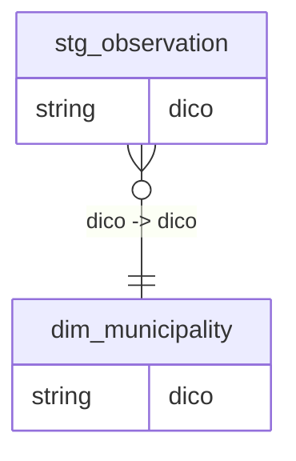

# Lógica: do manifest do dbt ao documento (spec 010)

Fonte única: o `manifest.json` do `dbt parse` do projeto inteiro (`analytics/dbt`), sem banco e sem lake. Tudo abaixo é
função pura desse dict mais `config/sources.yml`. Os contratos travados (`tests/contracts/test_modeldocs_contract.py`)
fixam o formato descrito aqui; em dúvida, o contrato vence.

## 1. Tabelas (`load_model`)

Para cada nó com `resource_type == "model"`:

| Campo | Regra |
|---|---|
| `name`, `unique_id` | do nó |
| `layer` | regex `/lake/(bronze\|silver)/` sobre `config.location`; senão `"n/d"` |
| `domain` | `tags[0]`; `"n/d"` se não houver tag |
| `kind` | `"relatorio"` se o nome começa com `rpt_` ou termina em `_coverage`; senão `"principal"` |
| `description` | `description` do nó; **string vazia vira `None`** (o dbt grava `''` quando falta) |
| `columns` | `node["columns"]` na ordem do dict (a do yml); `description` vazia vira `None`; `data_type` do nó |
| `tests` da coluna | nomes `test_metadata.name` dos nós `resource_type == "test"` com `attached_node == unique_id` e `column_name == coluna`; sem repetição, ordenados. **Testes singulares não têm `test_metadata`: ignore-os** (hoje são 24) |
| `source_ids` | `node["meta"].get("source_ids", [])` (declarado no schema.yml, task US3) |
| `origin_file` | `patch_path` sem o prefixo `<pacote>://`; se for `None`, `original_file_path` do nó |

**Armadilha: caminhos do Windows.** Em Windows o manifest traz barra invertida (`models\bronze\schema.yml`). Normalize
sempre: troque `\` por `/` e prefixe `analytics/dbt/`. O documento e as mensagens nunca podem mudar de acordo com o SO.

Ordem: `tables` por `(layer, domain, name)`; `relationships` por `(from_table, from_column, to_table, to_column)`.
O resultado não pode depender da ordem dos nós do manifest (o contrato inverte a ordem e exige os mesmos bytes).

## 2. Relacionamentos

Para cada nó `resource_type == "test"` com `test_metadata.name == "relationships"`:

- `from_table` = nome do modelo de `attached_node`; `from_column` = `column_name`.
- `kwargs["to"]` é texto: `ref('x')` ou `source('s', 't')` (aspas simples ou duplas, com ou sem espaço). Extraia o
  alvo com regex; `to_column` = `kwargs["field"]`.
- Alvo `ref('x')` → `to_table = "x"`. Alvo `source('s','t')` → `to_table = "t"` **se existir um modelo chamado `t`**
  (a fonte `caop_silver.dim_municipality` é a saída do modelo `dim_municipality` de outro build).
- Alvo que não resolve para um modelo → `ModelError` com o **arquivo yml** (`origin_file` do nó de teste), o **modelo**
  de origem e o **alvo** (FR-009). Exemplo de texto: `analytics/dbt/models/demo/schema.yml: o modelo fact_a aponta
  `dico` para source('ext', 'ghost_table'), que não corresponde a nenhum modelo`. O contrato exige só que os três
  nomes apareçam.
- Não deduplique: o número de arestas é exatamente o número de testes `relationships` (SC-001).

## 3. Esqueleto do documento (`render_markdown`)

Texto em português, `\n` como quebra de linha, termina com uma quebra de linha. Nenhuma data, hora, caminho local,
`run_id`, contagem de linhas ou valor de dado (FR-005, FR-006). **Os números e nomes do exemplo abaixo são
ilustrativos**; os reais saem do manifest.

````markdown
# Modelo de dados

> Arquivo gerado por `uv run --locked python -m pipelines.cli.model_docs`. Não edite à mão: o CI reprova se ele
> divergir dos `schema.yml` do dbt.

## Resumo

- Tabelas: 25 (bronze 14, silver 11)
- Relacionamentos declarados: 15
- Cobertura de descrição: tabelas 68%, colunas 12%

## Diagrama de relacionamentos



## Lacunas

### Cobertura de descrição

| Camada | Tabelas com descrição | Colunas com descrição |
| --- | --- | --- |
| bronze | 9/14 (64%) | 10/70 (14%) |
| silver | 8/11 (73%) | 4/60 (7%) |
| total | 17/25 (68%) | 14/130 (11%) |

### Sem descrição

- wikipedia_block
- wikipedia_block.block_id

### Chaves territoriais sem relacionamento declarado

- stg_caop_municipalities.dico

## Dicionário de dados

### stg_observation

- Camada: bronze | Domínio: observations | Tipo: principal
- Fontes: pordata (CC-BY-4.0); ine (CC-BY-4.0)
- Descrição: Observações municipais em formato longo.

| Coluna | Tipo | Descrição | Testes |
| --- | --- | --- | --- |
| dico | varchar | Código do município na CAOP. | not_null, relationships |

Relacionamentos: `dico` -> `dim_municipality.dico`
````

Regras de cada trecho:

- **Aresta** (uma por teste, uma linha): `    <from_table> }o--|| <to_table> : "<from_column> -> <to_column>"`, quatro
  espaços de indentação, exatamente esse formato (o contrato extrai por regex).
- **Entidades** do diagrama: só as que participam de alguma aresta, com os atributos = colunas usadas como
  `from_column` ou `to_column` naquela tabela, sem repetição, ordenadas. Tipo do atributo = `data_type` com tudo que
  não é `[A-Za-z0-9_]` trocado por `_` e em minúsculas, ou `n_d` quando não há `data_type`.
- **Lista de colunas** da tabela, `Tipo` = `data_type` ou `n/d`; `Descrição` = texto ou `sem descrição`; `Testes` =
  nomes separados por vírgula ou `—`.
- **Tabela sem descrição**: a linha `- Descrição: sem descrição`.
- **Tabela sem colunas declaradas**: em vez da grade, a linha `Colunas declaradas: nenhuma.`
- **Relatório** (`kind == "relatorio"`): acrescente à lista de propriedades `- Observação: as colunas listadas são só
  as declaradas no schema.yml; a lista pode estar incompleta.` Tabelas `principal` não levam a observação.
- **Fontes**: `source_ids` com a licença de `config/sources.yml` (`license_id`); `<id> (licença não declarada)` se a
  fonte não existir lá; `não declaradas` se `source_ids` for vazio. Se a fonte tiver `attribution`, acrescente
  ` — atribuição: "<texto>"` depois da licença (Google exige a atribuição).
- **`Relacionamentos:`** só aparece quando a tabela é origem de ao menos uma aresta, uma por aresta, ordenadas.
- **Dicionário**: uma seção `### <nome>` por tabela, na ordem de `tables`. O contrato procura `### <nome>\n`.

## 4. Lacunas

- **Cobertura**: por camada (`bronze`, `silver`) e total. Tabelas: quantas têm descrição / total. Colunas: quantas
  colunas **declaradas** têm descrição / total de colunas declaradas. Percentual = `round(100 * n / d)` arredondando
  metade para cima (`floor(100*n/d + 0.5)`), formato `n/d (p%)`; quando `d == 0`, escreva `n/d`. Camada `n/d` entra só
  no total. No `Resumo`, o percentual é o do total.
- **Sem descrição**: primeiro as tabelas sem descrição (`- <tabela>`), depois as colunas declaradas sem descrição
  (`- <tabela>.<coluna>`), ordenadas. Nada a listar: a linha `Nenhuma.`
- **Chaves territoriais sem relacionamento declarado**: colunas **declaradas** chamadas `dico` ou `dicofre` que (a) não
  são `from_column` de nenhuma aresta e (b) não são a chave da própria tabela, isto é, não têm os testes `unique` **e**
  `not_null`. Formato `- <tabela>.<coluna>`; nada a listar: `Nenhuma.`
- O contrato divide o texto em cada linha `### `; por isso nenhum texto livre pode começar com `### `.

## 5. Escrita e conferência (CLI)

- Gravação sempre com `\n` (nunca `\r\n`), UTF-8 sem BOM.
- `--check` lê o arquivo commitado, normaliza `\r\n` para `\n` nas duas pontas e compara. Em Windows o Git converte o
  arquivo para CRLF no checkout; sem a normalização a conferência falharia na máquina do autor e passaria no CI.
- Arquivo ausente conta como defasado.
