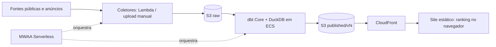

# living-recommender

Plataforma web que recomenda **onde morar em Portugal**, município a município e, dentro de cada município, freguesia a freguesia. A recomendação se baseia no orçamento de aluguel e nas preferências de cada pessoa.

> **Status:** implementação em andamento. A coleta da CAOP (em disco local ou em um bucket S3), as dimensões territoriais Bronze/Silver e a coleta do Pordata e do INE, com o staging de observações municipais e o relatório de cobertura, já estão disponíveis; veja como executar e visualizar a base no [guia de coletas](docs/runbooks/coletas.md). A arquitetura e o roteiro estão em [.docs/plano_plataforma_recomendacao_portugal.md](.docs/plano_plataforma_recomendacao_portugal.md).

*English summary: a public, anonymous, bilingual (PT-BR/EN) web app that ranks Portuguese municipalities (and their parishes) according to each user's rent budget and weighted preferences. Data is processed monthly on AWS, and recommendations are computed in the browser and rendered as an infographic. Status: implementation in progress; CAOP, Pordata and INE collection (local or S3) and municipal staging are available.*

---

## Como funciona

1. A pessoa informa **quanto pode pagar de aluguel** e a tipologia desejada (T0–T4+).
2. Escolhe a **preferência de clima** (ameno, quente ou fresco) e, para cada categoria (cultura, economia, emprego, educação, população, comunidade estrangeira, saúde, segurança, distância a capitais…), define:
   - **não importa**;
   - um **peso** de 0 a 5;
   - uma **faixa de valores** aceitável, usada como filtro eliminatório.
3. O sistema aplica essas preferências sobre uma **base vigente já processada** e mostra o resultado como **infográfico**: mapa, os melhores municípios, por que cada um foi recomendado, comparação com a média de Portugal, aluguel em relação ao orçamento, clima mês a mês e distâncias.
4. Ao abrir um município, a pessoa vê as **freguesias** ordenadas pelos mesmos critérios. Cada indicador informa se é próprio da freguesia ou herdado do município.

Não é preciso criar conta. As preferências ficam só no navegador e podem ser compartilhadas por URL.

## Princípios

- **Sem dados inventados.** Indicador ausente aparece como ausente; amostras pequenas são sinalizadas; cada número traz fonte e período de referência.
- **Explicável.** O score é uma média ponderada transparente, e a metodologia é pública.
- **Privacidade por padrão.** Sem cadastro, sem rastreamento; as preferências não saem do dispositivo.
- **Custo mínimo.** A meta é operar com menos de US$ 10/mês na AWS. O site é estático, e o processamento roda só uma vez por mês.

## Arquitetura (resumo)



| Camada | Tecnologia |
|---|---|
| Orquestração | Amazon MWAA Serverless (Apache Airflow) |
| Coleta | AWS Lambda (Python); CLI de upload para coletas manuais |
| Armazenamento | Amazon S3 (raw imutável → bronze/silver/gold em Parquet → JSON publicado) |
| Transformação | dbt Core + DuckDB em ECS Fargate |
| Frontend | React (exportação estática), MapLibre GL, i18n PT-BR/EN |
| Recomendador | Biblioteca TypeScript pura, guiada por um catálogo de critérios |
| Infraestrutura | Terraform; GitHub Actions com OIDC |
| Laboratório | Databricks Free Edition (exploração, Spark e ML, fora da produção — ver [ADR-001](sdd/adr/ADR-001-duckdb-producao-databricks-laboratorio.md)) |

Detalhes, alternativas e riscos estão nas seções 4 a 13 do [plano](.docs/plano_plataforma_recomendacao_portugal.md).

## Fontes de dados

| Fonte | Uso | Nível |
|---|---|---|
| CAOP (DGT) | Limites e códigos oficiais de municípios e freguesias | Município / freguesia |
| Pordata / INE | Cultura, economia, emprego, salários, educação, população, saúde, segurança, migração, rendas medianas de novos contratos (INE) | Município / freguesia (rendas, onde houver) |
| AIMA (condicional) | Estrangeiros residentes por nacionalidade (comunidade brasileira e lusófona) | Município, se disponível |
| SNS Transparência (condicional) | Utentes sem médico de família | ACES, herdado pelos municípios |
| Censos 2021 (INE) | População e faixas etárias | Freguesia |
| Open-Meteo Histórico (`era5`); WWO como fallback futuro | Coleta diária municipal de 24 meses; score e extremos em etapa futura | Ponto representativo da CAOP |
| Anúncios de arrendamento (Idealista) | Aluguel pedido, **só agregado** (mediana, P25–P75, n) | Município / freguesia |
| Wikipedia | Texto descritivo dos municípios (CC BY-SA, com atribuição) | Município |

Os anúncios são coletados manualmente, uma vez por mês e em baixa frequência, até a integração com a API oficial do Idealista, já solicitada. Nenhum anúncio individual é publicado. Licenças e regras de uso de cada fonte estão nas seções 3.4 e 5 do plano.

**Atribuições:** CAOP: Fonte: Direção-Geral do Território (DGT), CAOP2025, licença CC-BY-4.0. INE: Instituto Nacional de Estatística, IP – Portugal, licença CC BY 4.0 (cite o indicador e o período). Pordata: os Termos Legais não concedem licença de reutilização; a coleta é um risco aceito pelo autor e nenhum dado dessa fonte é redistribuído (detalhes em [guia de coletas](docs/runbooks/coletas.md)). O catálogo de fontes, com URLs, versão e licença, é o [config/sources.yml](config/sources.yml).

Para executar as coletas disponíveis (CAOP, Pordata e INE) e o staging de observações, consulte o [guia de coletas](docs/runbooks/coletas.md).

A ingestão climática da spec 003 oferece `collect_open_meteo` (308 municípios, retomada por cota, sem chave) e `build_climate` (staging diário, cobertura de lacunas e divergência dos pontos). São 13 variáveis de 2024-11-01 a 2026-10-31, preservando nulos e o dia local. O plano gratuito é restrito a uso não comercial, risco aceito pelo autor; atribuição Open-Meteo/ERA5 acompanha os registros. A verificação local, a coleta real e o CI remoto são registrados separadamente no [guia de coletas](docs/runbooks/coletas.md).

Para coletar sem intervenção nas renovações de cota: `uv run --locked python -m pipelines.cli.collect_open_meteo --local --continuous`. Esse modo salva checkpoints a cada 10 municípios, aguarda o prazo do servidor e repete falhas temporárias com espera exponencial. Ctrl+C encerra com progresso salvo; erros permanentes exigem correção. Ao concluir, rode `uv run --locked python -m pipelines.cli.build_climate --local`.

O comando mantém a configuração do catálogo lida no início. Alterações de modelo, janela ou variáveis passam a valer na próxima execução, que recoleta os municípios incompatíveis.

A coleta real e o build locais foram concluídos: **308/308 municípios, 2.922.920 observações e nenhuma lacuna nas 13 variáveis**. Alertas dos pontos e evidências de validação estão no guia de coletas; os dados reais permanecem fora do Git.

## Roteiro

| Fase | Entrega | Estado |
|---|---|---|
| 0 | Higiene do legado e fundação do repositório | A fazer |
| 1 | Fundação AWS (Terraform, orçamento, OIDC) e PoC do MWAA Serverless | A fazer |
| 2 | Dimensão territorial e coletores das fontes públicas | A fazer |
| 3 | Modelagem dbt (municípios e freguesias) com testes de qualidade | A fazer |
| 4 | Recomendador e site com resultado infográfico | A fazer |
| 5 | Operação mensal, rollback e medição de custo | A fazer |

Marco intermediário: uma **v0 só com municípios** publicada por volta da semana 12–14. O drill-down por freguesia entra como v1.1. Itens posteriores ao MVP: API oficial do Idealista, modelo de ML de aluguel em escala nacional, API dinâmica.

## Estrutura do repositório

Estado atual:

```text
.docs/                   plano de arquitetura e implementação
.planning/               fluxo de desenvolvimento SDD (templates, scripts, backlog, constitution)
.agents/                 skills do agente de desenvolvimento
sdd/                     ADRs (adr/) e specs das features (specs/)
config/sources.yml       catálogo de fontes (CAOP)
pipelines/               coletores (CAOP, Pordata, INE), storage local/S3 e CLIs (collect, load, build, view)
analytics/dbt/           modelos Bronze/Silver, seed de sinônimos de município e testes de qualidade
tests/                   unitários, integração, contrato e fixtures sintéticas
docs/runbooks/           guias de operação (coletas)
```

Dados gerados ficam em `.data/`, ignorada pelo Git. O lake segue `raw/` imutável → `lake/bronze/` → `lake/silver/`; ainda não há `lake/gold/` nem `published/`.

Estrutura prevista completa (seção 11 do plano), com o que ainda não existe:

```text
apps/web/                 site
packages/ranker/          biblioteca do recomendador
pipelines/                coletores, CLI de upload, workflows, imagens ECS
extension/idealista/      extensão de coleta manual
analytics/dbt/            modelos, seeds e testes
databricks/               laboratório Spark/ML, fora da produção (ADR-001)
infrastructure/terraform/ infraestrutura
config/sources.yml        catálogo de fontes
docs/runbooks/            operação (ADRs ficam em sdd/adr/)
```

## Como contribuir

O desenvolvimento segue um fluxo de *Spec-Driven Development* descrito em [.planning/README.md](.planning/README.md):

1. Decisões de arquitetura → ADR em `sdd/adr/`.
2. Cada funcionalidade → `spec.md` → `plan.md` + `tasks.md` → implementação → convergência, em `sdd/specs/`.
3. Ideias e bugs → [.planning/backlog.md](.planning/backlog.md).

**Ambiente local (Python).** Requer [uv](https://docs.astral.sh/uv/); o projeto usa Python 3.12 (`.python-version`). Na raiz do repositório:

```powershell
uv sync --locked
uv run --locked ruff check pipelines tests
uv run --locked python -m pytest -q --basetemp .pytest_tmp
```

Os testes não usam rede nem conta AWS; o S3 é simulado com moto. A coleta, o build e a visualização estão no [guia de coletas](docs/runbooks/coletas.md). As instruções de Node e Terraform serão adicionadas quando esses componentes existirem.

**Regras básicas:**

- Nenhum segredo no Git. Credenciais ficam no AWS SSM Parameter Store ou em `.env` local, que o Git ignora.
- Mensagens de commit curtas, em inglês.
- Todo PR passa por lint, testes, testes dbt e `terraform plan` antes do merge.

## Origem

Este projeto evolui dois trabalhos anteriores do autor:

- **MPAlugueisLisboa** — TCC (2023) de previsão de aluguéis na Região de Lisboa. Dele vêm os processadores do Pordata, a pontuação climática e a análise exploratória.
- **IdealistaScraper** — extensão de navegador para coleta de anúncios de arrendamento.

O que é reaproveitado e o que é reescrito está na seção 3 do plano.

## Licença

A definir.
